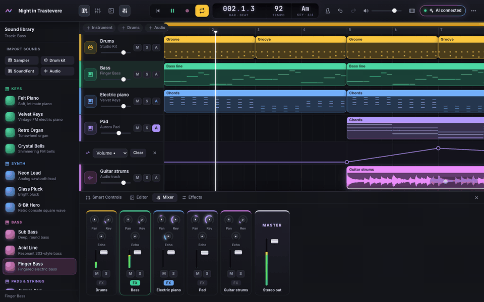
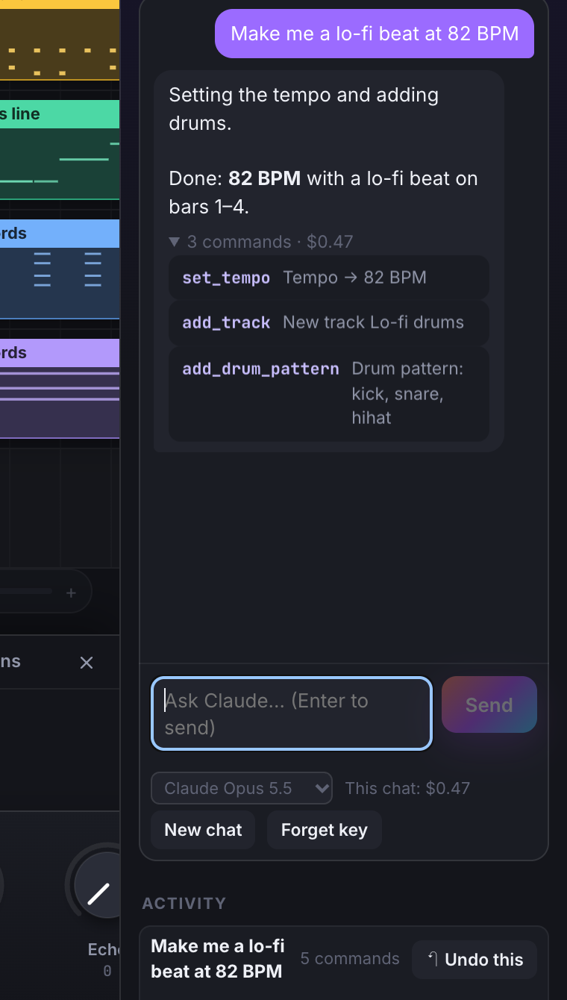
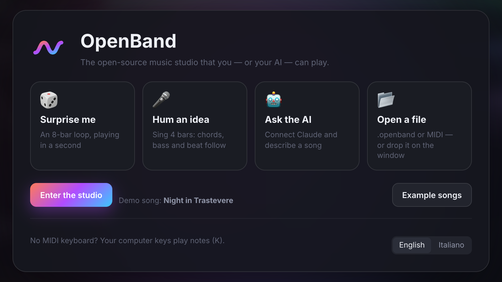
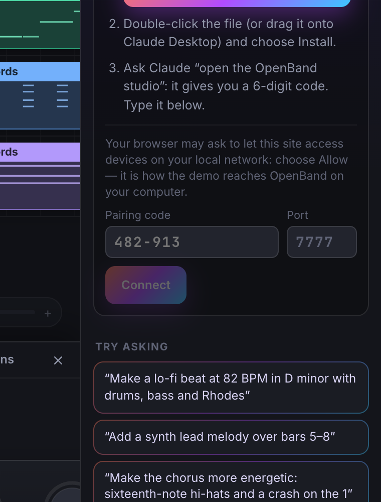
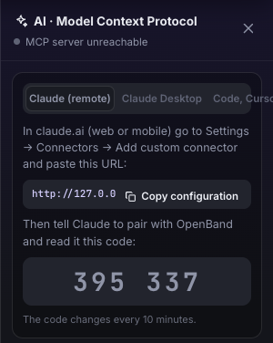

# OpenBand

🇬🇧 English · 🇮🇹 [Italiano](README.it.md)

**An open-source, GarageBand-style music studio that runs in your browser — and that your AI can play too, through the Model Context Protocol (MCP).**

### ▶ [Try the live demo](https://iltempe.github.io/openband/) — nothing to install



Ask Claude (or any MCP client) *“make a lo-fi beat at 82 BPM in D minor with drums, bass and Rhodes, then loop it”* and watch the tracks, notes and mixer move in real time.

OpenBand is a *clean-room* implementation: it reproduces the workflow of a consumer DAW (tracks, regions, piano roll, step sequencer, Smart Controls, mixer, musical typing) with code and sounds written from scratch. It contains no Apple code, samples, loops or artwork — every instrument is synthesized in real time — so it is freely redistributable under the MIT license.

## Features

- **Arrangement**: instrument, drum and audio tracks; MIDI regions you can drag, resize, duplicate (⌥-drag or ⌘D) and move between tracks of the same kind; ruler with cycle (loop) and zoom (⌘ + wheel).
- **Piano roll**: add, move, stretch and delete notes; grid from 1/4 to 1/32 plus triplets; transpose, quantize and velocity.
- **Drum step sequencer**: 11 pieces (kick, snare, clap, rim, closed and open hi-hat, 3 toms, crash, ride), paint by dragging, accents.
- **15 synthesized instruments**: piano, FM electric piano, organ, bells, lead, pluck, 8-bit, 3 basses, pad, strings and 3 drum kits (Studio, Trap 808, Lo-Fi).
- **Import your own sounds**: turn audio files into a playable **sampler** (note names in file names set the keys, otherwise the pitch is detected), build **drum kits** from samples (kick, snare, hat… recognised by name), load instruments from **SoundFont (.sf2)** libraries, or drop audio files on the timeline.
- **Audio tracks** with waveforms: clips with gain and start trim, included in the WAV export.
- **Smart Controls**: per-track volume, pan, brightness (filter), reverb and echo.
- **Per-track effects**: amp simulator (drive, cabinet tone, level), 3-band EQ with sweepable mids and a compressor with gain-reduction meter.
- **Automation** of volume, pan, brightness, reverb and echo: draw curves in a lane under each track.
- **Plugins (Web Audio Modules 2.0)** — the open plugin standard of the web: browse the community collection of synths, drum machines, amps, pedals and reverbs, or load any WAM from a URL. Plugin instruments play your MIDI, plugin effects go in each track's chain, their own windows open inside the studio and their settings are saved with the project and rendered in the WAV export.
- **Mixer** with level meters, faders, mute and solo, sends and master.
- **Musical typing** (keys A–' like a piano, Z/X for octave, C/V for velocity) and **Web MIDI** for external controllers.
- **Live recording** into new regions, with metronome.
- **Microphone recording and hum-to-MIDI**: record your voice or an instrument onto an audio track after a one-bar count-in (with latency compensation), or *hum a melody* and get it back as MIDI notes, snapped to the key and gently quantized. Any monophonic audio clip can be converted the same way. When the AI asks to record, you always confirm first.
- **MIDI import and export** (Standard MIDI Files, General MIDI programs, drums on channel 10).
- **The AI listens**: `analyze_mix` renders the song and measures it — loudness (EBU R128 LUFS, true peak, LRA), frequency balance in 7 bands, stereo/phase, masking between tracks, the key — and returns concrete fixes (*“Bass and Drums cover each other at 60–250 Hz: cut 2–3 dB around 80 Hz…”*). `render_spectrogram` gives Claude an image of the mix to look at, and `analyze_harmony` reads the chords with their degrees in the key (*Am7 i7 · Fmaj7 VImaj7 · V7/V…*) and the cadences. The same reports are in the **Analysis** panel (N).
- **Play together, with the AI as the third musician**: open a room from the people button, share the link (and the password) and everyone edits the same song live — different notes of the same region merge on their own (Yjs CRDT). You see who's on which track, imported sounds travel to whoever lacks them, play/stop can follow the host, and **undo only takes back your own work**. The AI connected to your browser acts in the room like anyone else, and the others see what it did and for whom.
- **Jam with the AI (call-and-response)**: turn on *Jam* in the AI panel, play a phrase and the AI answers on the next bar or at the loop start — LLM latency is hidden by quantizing the answer to the next musical window (if it arrives too late it moves to the following one, never mid-bar, never over the previous answer). Answers are heard but not saved: they show as glowing ghost notes in the piano roll until you press **Keep**.
- **Versions and branches, like git for songs**: save versions, branch off to try another direction (*“what if the chorus were slower?”*), go back at any time (undoable; unsaved work is kept as a WIP version), and **merge** branches three-way — changes on different tracks, regions or fields combine by themselves, real conflicts are listed with *keep ours / take theirs*. The **compare view** colours the timeline (green added, yellow changed, red dashed removed), shows the other version's notes as ghosts in the piano roll, and lets you A/B the two versions in sync. `export_project_json({canonical:true})` writes deterministic JSON for git.
- **Explain mode**: right-click a region, a section or selected notes and choose **Explain** — the AI answers with a comment pinned right there (*“C in first inversion: E in the bass softens the move from Fmaj7…”*). Turn on **Teach me** and the AI annotates its non-obvious choices while it works. Comments live in the song (threads, replies, resolve), survive export and undo, and are kept — marked *deleted* — if their target goes away.
- **Takes, comping and blind A/B**: every region can hold alternative takes — recorded in cycle mode (one per pass, as in GarageBand) or written by the AI (*“give me 4 bass lines”*). Comp the best parts by dragging across the take lanes, or run a **blind test**: the takes loop as A/B/C/D in random order, you rank them, and only then the names are revealed (and the AI gets your ranking).
- **Flub markers**: while recording press **F** when you slip (**G** for a part worth keeping; Shift+F / Shift+G when musical typing is open) or step on a MIDI pedal (CC64 by default, or any controller with *Learn*). Red and green flags land on the ruler, on the region and on the take; the **To fix** panel lists them, `]` / `[` jump to the next / previous one with a 2-bar loop around it, and **Best take** comps in, over the bars around the mistake, the take with no slip there and the most good marks. The AI is told as you mark (`flub` events) and can offer to fix them.
- **Reference matching**: load a song you'd like to sound like (it stays off the timeline), flip **A/B** in the mixer to hear it at the same loudness as your mix and at the same point in the song, and compare: loudness, dynamics, width and the 1/3-octave balance after loudness matching, with suggestions such as *“+2.5 dB above 6 kHz on the master”* or *“cut 2 dB at 250–500 Hz on the Pad, the loudest track there”*.
- **Song structure**: mark intro, verses, choruses… in the *Structure* lane above the ruler (or let *Suggest* find them from repetitions). Click a section to loop it, drag it to move it with all its content (⌥ pushes the rest of the song), right-click to duplicate or delete it. The AI works in sections too: *“add one more chorus at the end”*, *“make the second verse bigger”*.
- **Lyrics**: write the words per section in the **Lyrics** panel; Italian lyrics are split into metric syllables (with synalepha: *canto e ballo* = 4) and stressed syllables are marked, English too. Align them to the melody track: syllables appear under the track and inside the piano-roll notes, and prosody problems — stressed syllables on weak beats, long notes on unstressed endings, words cut by rests, syllables vs notes — are underlined and listed. Export a **ChordPro** or chords-over-lyrics sheet.
- **Musical linter**: the **Problems** panel (badge in the toolbar) checks the song after every change — notes out of key, overlapping notes and regions, notes past the end of a region, two bass parts clashing below E2, crowded registers, mechanical velocity or timing, empty tracks, panned bass — most with a one-click fix. The AI runs the same checks with `lint_project`, and so can your CI.
- **The AI follows along**: phrases you play (split after a bar of silence), what you select, play/stop, your edits and questions typed in *Ask the AI* reach the connected AI as events. A switch in the AI panel turns activity sharing off (questions are always sent).
- **Undo by intent**: everything the AI does for one request is a single, labelled undo step (*“Undo: Lo-fi beat (23 commands)”*); drags and knob turns are one step each. **Plugins included**: whatever you change in a plugin's own window (presets, modes, wavetables — not just automatable knobs) and every `set_plugin_params` is an undo step too, and undo puts the plugin back in exactly the state it was in.
- **Undo/redo**, autosave, **WAV export** with offline rendering; projects with imported sounds are saved as a single `.openband` file that bundles the samples.
- **AI control via MCP**: 112 tools to compose, arrange, import sounds, add plugins, mix, automate and export — the AI can add a plugin just from a description such as *“a warm tube overdrive”*.
- **English and Italian** interface (switch from the start screen or the ⋯ menu).

| Piano roll | Mixer |
|---|---|
|  |  |
| **Effects** | **Audio track** |
|  |  |
| **Analysis (what the AI hears)** | **Spectrogram (what the AI sees)** |
|  |  |
| **Problems (musical linter)** | **Lyrics and prosody** |
|  |  |
| **WAM plugin window** | **Plugin browser** |
|  |  |
| **Play together: room, link, people** | **What the others see (avatars, the AI's activity)** |
|  |  |
| **Jam: the AI answers what you play** | **The answer as ghost notes, until you keep it** |
|  |  |
| **Versions: branch graph and compare view** | **Ghost notes of the other version** |
|  |  |
| **Explain mode: comments pinned to the song** | **The AI's explanations, per request** |
|  |  |
| **Takes and comping** | **Blind A/B test** |
|  |  |
| **Reference matching** | **A/B with the reference** |
|  |  |
| **Microphone: record or hum** | **The AI asks before recording** |
|  |  |
| **Flub markers: the To fix panel** | **Flags on the takes** |
|  |  |

> The online demo works with your AI three ways: paired with the OpenBand server on your computer (a 6-digit code), with your own Anthropic API key right in the page, or — on a self-hosted OpenBand — as a claude.ai connector. See [Connect an AI](#connect-an-ai-mcp).

## Quick start

```bash
npx openband
```

That's it: the studio opens in your browser (Node 18+). No clone, no build. Prefer zero install? [Open the online demo](https://iltempe.github.io/openband/).

**Install it as an app:** in Chrome or Edge, *⋯ → Install OpenBand* (or the install icon in the address bar); in Safari, *Share → Add to Dock*. It opens in its own window, works offline after the first visit (synths, editing, analysis, exports — plugins and fonts are kept once used) and, where the browser supports it, opens `.openband`, `.mid` and `.dawproject` files with a double-click.

**Just a browser and an API key:** open the [online demo](https://iltempe.github.io/openband/) → **AI** panel → *Connect AI* → *API key*, paste your Anthropic key and chat: Claude runs inside the page and plays the studio with the same tools it gets over MCP (each request is one undo step, the cost of each answer is shown, *Stop* is always there). The key stays in your browser's storage, never in songs or exports, and requests go from your browser straight to Anthropic.



**Claude Desktop — two steps, nothing to install:**

[**⬇ Download OpenBand for Claude Desktop**](https://github.com/iltempe/openband/releases/latest/download/openband.mcpb) → double-click the file (or drag it onto Claude Desktop) → *Install*. Then ask Claude for a song: the studio opens in your browser by itself. Claude Desktop already includes Node; the extension's settings let you change the port, turn off the automatic opening and pick a samples folder Claude can import sounds from by name.

**Other AI clients:** add OpenBand to your MCP client — `npx openband setup` finds Claude Desktop, Claude Code, Cursor and VS Code on your computer and does it for you (it asks first and keeps a backup of each file). See [Connect an AI](#connect-an-ai-mcp) for doing it by hand.

> The `openband` npm package and the `.mcpb` extension are published with the v0.2 release. Until then, use a checkout (see [Development](#development)).

The first screen starts with music, not a tutorial: **🎲 Surprise me** builds and plays an 8-bar loop in a fraction of a second (a random progression among 12, in a random key, with drums and bass — no AI needed), **🎤 Hum an idea** turns 4 sung bars into a melody with chords, bass and a beat under it, **🤖 Ask the AI** opens the connection wizard, **📂 Open a file** takes a song or a MIDI file. *Example songs* has 8 small songs (lo-fi, pop ballad, trap, house, rock, bossa nova, singer-songwriter, ambient) that explain their own choices in the Comments panel. A 5-step tour follows what you actually do (play, make a region, add a note, open the mixer, meet the AI) and can be skipped or replayed from the ⋯ menu; `?` shows every keyboard shortcut.



## Sounds, effects, automation and MIDI

- **Your own sounds**: use *Import sounds* at the top of the library. *Sampler* turns audio files into an instrument (name them like `Piano_C4.wav` to set the keys, otherwise the pitch is detected); *Drum kit* maps files named kick, snare, hat, clap, tom… to the kit; *SoundFont* opens a `.sf2` library and lets you pick presets; *Audio* puts files on the timeline. You can also drop files anywhere on the studio. Free SoundFonts to try: FluidR3_GM (MIT) or GeneralUser GS.
- **Saving**: projects with imported sounds are saved as one `.openband` file that contains the samples, so they open anywhere. Songs saved by older versions open as usual and are upgraded automatically.
- **Effects**: select a track and press **F** (or click *FX* on a mixer strip). Each unit has its own power button.
- **Automation**: click **A** on a track to open its lane, choose the parameter, click to add points, drag to move them, double-click to delete.
- **MIDI**: *Import MIDI…* / *Export MIDI* in the ⋯ menu, or drop a `.mid` file on the studio.
- **Plugins**: click *Plugins* in the library and describe what you need (*“wide dark reverb”*, *“synth monofonico”*) or filter by instruments/effects; instruments get their own track, effects are added to the selected track (also from *+ Plugin* in the Effects panel). *Edit* opens the plugin's window. Plugins come from the [WAM community collection](https://github.com/boourns/wam-community) and need an internet connection the first time they load.

### Lint your songs in CI

If you keep songs in a Git repository, check every pull request with the OpenBand linter:

```yaml
# .github/workflows/songs.yml
on: [push, pull_request]
jobs:
  lint:
    runs-on: ubuntu-latest
    steps:
      - uses: actions/checkout@v4
      - uses: iltempe/openband/.github/actions/openband-lint@main
        with:
          files: songs/*.openband.json songs/*.openband
          fail-on: error        # or warn / info / none
```

Problems appear as annotations on the pull request. Locally: `node scripts/openband-lint.mjs song.openband.json [--format=text|json|github] [--fail-on=warn]`. Rules can be disabled or re-graded per song in `project.lint` (`disabled`, `severity`, `ignored`).

### Host your own OpenBand

The studio is a static app, so it runs anywhere — for a school, a community or just yourself:

[](https://app.netlify.com/start/deploy?repository=https://github.com/iltempe/openband) [](https://vercel.com/new/clone?repository-url=https://github.com/iltempe/openband)

- **GitHub Pages from your fork:** fork → *Settings → Pages → Source: GitHub Actions* → *Settings → Secrets and variables → Actions → Variables*: `OPENBAND_DEPLOY = true`. Forks don't deploy until you opt in.
- **Cloudflare Pages:** connect the repository with the *Vite* preset (build `npm run build`, output `dist`), or `wrangler pages deploy dist`.
- **Docker** (NAS, Raspberry Pi, a school server; amd64 and arm64): `docker run -p 8080:7777 ghcr.io/iltempe/openband`, or `docker compose up -d` with the included `docker-compose.yml` (multiplayer rooms on, healthcheck on `/version.json`).
- **Settings without rebuilding:** put a `config.json` next to `index.html` (or point `OPENBAND_CONFIG` to one in Docker) — instance name, default language, features to turn off (the in-browser chat, plugins, rooms), plugin catalog URL, collaboration server. See [`config.example.json`](config.example.json).
- Every host gets the same headers: assets cached forever, the page and the service worker never, and a Content-Security-Policy (`server/csp.mjs`) that lets the page reach only the bridge on the user's computer, the Anthropic API, the plugin catalog and the collaboration servers. A static instance stores nothing: songs stay in each visitor's browser. Cross-origin isolation (COOP/COEP, for future `SharedArrayBuffer` use) is not enabled yet.

### Play together

- **On the same network** (fastest): start the MCP server with `OPENBAND_COLLAB=1` — it then also serves the studio and a room relay on your LAN address (printed at start; the AI bridge itself stays reachable only from this computer). Open a room with *On this network* and send the link.
- **Peer to peer**: *Peer to peer* connects the browsers directly with WebRTC; the link opens the online demo. Peers find each other through a signaling server: OpenBand's own (`/signal` on a server started with `OPENBAND_COLLAB=1`) or y-webrtc's public one, and you can pass your own with `?signal=wss://…` (it travels with the link). Public signaling servers come and go, so for reliable sessions over the internet run one you control.
- A password encrypts peer-to-peer traffic and separates rooms with the same name; send it apart from the link.

## Connect an AI (MCP)

```
AI client (Claude Desktop, Claude Code, Cursor…)
        │  stdio · MCP
        ▼
server/mcp-server.mjs ──── WebSocket ws://127.0.0.1:7777/bridge ────▶ OpenBand in the browser
```

The client launches the MCP server, which forwards every call to the open OpenBand window. Each command received shows up in the app's **AI** panel (the “MCP” button, top right).

**Claude Code**:

```bash
claude mcp add openband -- npx -y openband mcp
```

**Claude Desktop, Cursor, VS Code…** — or run `npx openband setup`. Claude Desktop keeps the file in `~/Library/Application Support/Claude/claude_desktop_config.json` (macOS) or `%APPDATA%\Claude\claude_desktop_config.json` (Windows):

```json
{
  "mcpServers": {
    "openband": { "command": "npx", "args": ["-y", "openband", "mcp"] }
  }
}
```

No paths to edit: `npx` fetches the package, which ships the studio already built. The first tool call opens the studio in your browser by itself.

Then ask, for example:

> Make a lo-fi beat at 82 BPM in D minor with drums, bass and Rhodes, then start the loop.

> Add a warm tube overdrive to the bass and a wide reverb to the pad, then open the overdrive so I can tweak it.

> Import ~/Samples/vocal.wav as an audio track at bar 5, put a compressor on the bass, fade the pad in over two bars and save the song as ~/Desktop/song.wav and song.mid.

Environment variables: `OPENBAND_REMOTE_MCP=1` and `OPENBAND_REMOTE_TOKEN` (remote MCP at `/mcp`, see below), `OPENBAND_PORT` (default 7777; when it is taken the next free port is used and the studio opens with `?mcp=<port>`), `OPENBAND_OPEN_BROWSER=0` (don't open the browser), `OPENBAND_COLLAB=1` (multiplayer rooms on your network), `OPENBAND_NO_UPDATE_CHECK=1` (don't ask npm once a day whether a newer OpenBand exists) and `OPENBAND_DEV_URL` (default `http://localhost:5173`, used when there is no build). Trouble? `npx openband doctor` checks Node, the port (and who is using it), the build, the packages and your MCP clients, with a fix for each ✗. In the studio, *⋯ → Diagnostics* shows audio, bridge, permissions, storage, plugins and recent errors, and *Report a problem* opens a pre-filled GitHub issue — without anything from your songs and never your keys — that you read before posting.

**From the online demo.** The demo can drive the OpenBand server on your computer too: open the **AI** panel → *Connect AI*, install the extension (or run `npx openband mcp`), and type the 6-digit **pairing code** that Claude gives you when you ask it to open the studio (the server also prints it when it starts). The tab gets a session token, so reloading doesn't ask again; restarting the server revokes it. Your browser may ask to let the site access your local network — that is how the page reaches `127.0.0.1`: choose *Allow*. If your browser refuses, *Open the local studio* takes the song you have open to the studio served on your computer.



The bridge only accepts connections over loopback: from pages served on localhost (no code needed) and from the sites in `OPENBAND_ALLOWED_ORIGINS` (default `https://iltempe.github.io`), which must pair first — 5 wrong codes in a minute lock pairing for 5 minutes, codes expire after 10 minutes.

**From claude.ai, web and mobile (remote MCP).** A self-hosted OpenBand started with `OPENBAND_REMOTE_MCP=1` also speaks MCP over Streamable HTTP at `/mcp`, so it can be added in claude.ai under *Settings → Connectors → Add custom connector* (also from a phone):

```
claude.ai ──HTTPS · MCP──▶ https://music.example/mcp ──WebSocket──▶ the user's OpenBand tab
```

1. Run it: `docker run -p 8080:7777 -e OPENBAND_REMOTE_MCP=1 -e OPENBAND_REMOTE_TOKEN=<a long random string> ghcr.io/iltempe/openband`, behind HTTPS (Caddy, nginx… forwarding the `Host` header).
2. In claude.ai add the connector `https://music.example/mcp?token=<the token>`.
3. Open the studio → **AI** → *Connect AI* → *Claude (remote)*: the tab shows a 6-digit code. Tell Claude “pair with OpenBand, code 395 337” (or add `&pair=<code>` to the connector URL).



The server is only a relay and stores nothing: songs stay in the tab. Each MCP session drives the one tab it paired with — other tabs, even on the same server, are invisible to it — and no tool works before pairing (`pair_studio`). Codes change every 10 minutes and are spent once used; 5 wrong codes per session per minute (30 across all sessions) block pairing for a minute; tool calls are rate-limited per session (60 every 10 s) and idle sessions end after 30 minutes. In this mode files are imported only from public http(s) URLs (never local paths, and never addresses of the server's own network), and exports have no `save_to`: the file downloads in the tab. Closing or reloading the tab ends the pairing. `OPENBAND_REMOTE_TOKEN` is optional but strongly advised on a public address: without it, anyone who knows the URL can open sessions (they still need a code from a tab).

### MCP tools

| Area | Tools |
|---|---|
| Project | `pair_studio` (remote MCP only), `open_studio` (local only), `get_project`, `get_status`, `list_instruments`, `new_project`, `rename_project`, `set_tempo`, `set_key`, `set_master_volume`, `export_project_json`, `import_project_json` |
| Studio events | `get_events`, `wait_for_event` (phrases you play, selection, transport, edits, questions from *Ask the AI*); resource `openband://project` with change notifications |
| Undo | `begin_change` / `end_change` (one undo step per request, with a label), `get_history` (with `plugins_changed` per step), `undo` / `redo` (with `steps`; plugin states included) |
| Tracks | `add_track` (instrument, drums or audio), `update_track` (instrument, volume, pan, mute, solo, reverb, echo, tone), `delete_track` |
| Sounds | `import_sample`, `list_samples`, `create_sampler_instrument`, `import_soundfont`, `add_audio_region` — files are read from a local path or an http(s) URL |
| Structure | `get_structure` (sections with an energy profile), `add_section`, `update_section`, `delete_section`, `move_section`, `duplicate_section` (with ripple), `split_region`, `auto_sections` |
| Lyrics | `set_lyrics`, `get_lyrics`, `align_lyrics`, `check_prosody`, `suggest_melody_rhythm`, `export_chord_sheet` (ChordPro or text, optional `save_to`) |
| Linter | `lint_project` (symbolic rules, optionally audio ones), `apply_fix`, `ignore_issue`; `update_notes` edits notes in place |
| Listening | `analyze_mix` (bars or section, per track, summary/full), `render_spectrogram` (returns an image), `detect_key` (MIDI, audio or both), `analyze_harmony` (chords, Roman numerals, functions, cadences) |
| Multiplayer | `create_room` (LAN or peer-to-peer, optional password), `join_room`, `leave_room`, `get_peers` |
| Jam | `set_jam_mode` (response track, window), `play_phrase` (ephemeral notes at `next_bar`, `next_loop` or a bar; optional `commit`), `keep_answer`; the user's phrases arrive as `phrase` events |
| Versions | `save_version`, `list_versions`, `create_branch`, `checkout` (branch or version, undoable, auto-saves WIP), `diff_versions` (readable summary + structured changes), `merge` (three-way; `strategy` and per-entity `pick`); `export_project_json` with `canonical` |
| Explain | `annotate` (project, track, region, notes, section or bar range; markdown up to 500 characters), `list_annotations`, `resolve_annotation`, `delete_annotation`; `get_status` reports `teach_mode` |
| Takes | `add_take`, `list_takes`, `set_active_take`, `delete_take`, `comp_takes` (segments, notes cut at the boundaries), `start_ab_test` (blind test; the ranking arrives as an `ab_result` event) |
| Flubs | `add_flub` (playhead or bar/beat; kinds flub / good / note), `list_flubs`, `resolve_flub`, `delete_flub`, `replace_with_best_take`; `flub` events as the user marks |
| Reference | `import_reference` (path or URL, optional excerpt), `compare_to_reference` (loudness-matched differences and suggestions), `clear_reference` |
| Recording | `record_audio` (microphone, count-in, mode `audio` or `hum`; the user confirms), `audio_to_midi` (monophonic audio → notes, snap to key, quantize with strength) |
| Mix | `set_track_effects` (amp, EQ, compressor), `set_automation`, `clear_automation` |
| Plugins | `add_plugin` (from a plain-language description), `search_plugins`, `list_plugins`, `add_plugin_instrument`, `add_plugin_effect`, `remove_plugin_effect`, `set_plugin_bypass`, `get_plugin_params`, `set_plugin_params`, `show_plugin` |
| Files | `export_wav`, `export_midi` (optionally `save_to` a path), `import_midi` |
| Regions | `add_region`, `update_region`, `delete_region`, `duplicate_region`, `open_editor` |
| Notes | `get_region_notes`, `add_notes`, `remove_notes`, `transpose_region`, `quantize_region` |
| Composition | `add_drum_pattern` (step strings like `"x...x...x...x..."`), `add_chord_progression` (`["Am7","Fmaj7","C","G"]`, block, arpeggio or stabs style) |
| Transport | `transport` (play, stop, toggle, rewind), `set_loop`, `set_metronome`, `open_studio` |

Conventions: 4/4 time; bars start at 1; inside a region, positions and durations are in beats (0.25 = a sixteenth); pitches are MIDI numbers, names (`"C4"`, `"F#3"`) or, on drum tracks, piece names (`"kick"`, `"snare"`, `"hihat"`…).

## Shortcuts

| Key | Action |
|---|---|
| Space / Enter | Play/Stop · Back to start |
| R · C · M | Record · Cycle · Metronome |
| K | Musical typing (Esc to close) |
| Y · B · E · X · F · N | Library · Smart Controls · Editor · Mixer · Effects · Analysis |
| ↑ ↓ | Previous or next track |
| ⌘Z / ⇧⌘Z | Undo / Redo |
| ⌘D · ⌫ | Duplicate region · Delete notes or region |
| ⌘A (in the editor) | Select all notes |
| ? | All keyboard shortcuts |

## Development

```bash
git clone https://github.com/iltempe/openband.git
cd openband
npm install
npm run dev         # studio with hot reload
npm run typecheck   # TypeScript
npm test            # unit tests (Vitest, run in Node)
npm run build       # production build in dist/
node bin/openband.mjs mcp   # the MCP server from the checkout (or: claude mcp add openband -- node /path/to/openband/bin/openband.mjs mcp)
node scripts/smoke-pack.mjs # pack the npm package, install it in an empty folder and test it
npm run pack:mcpb           # build/openband-<version>.mcpb for Claude Desktop (then npm run smoke:mcpb)
npm run e2e                 # the built studio in Chrome: first run under 3 s, offline PWA
```

CI runs typecheck and tests on every push and pull request, plus the packaged builds (npm tarball on 3 OSes × Node 18/20/22, the `.mcpb`), the e2e checks and a release dry run. Releases: see [docs/RELEASING.md](docs/RELEASING.md) — one tag publishes the npm package, the extension and the demo at the same version. The v0.2 roadmap is specified in [docs/SPEC.md](docs/SPEC.md); changes are listed in [CHANGELOG.md](CHANGELOG.md).

## Code structure

```
src/
  types.ts, music.ts      data model, theory (notes, chords, drum map)
  store.ts                state (zustand), undo/redo, autosave
  commands.ts             command API, shared by the UI and MCP
  bridge.ts               WebSocket client to the MCP server
  input.ts                musical typing, Web MIDI, recording
  audio/instruments.ts    synthesized presets (Tone.js)
  audio/engine.ts         live audio graph, transport, metronome, meters
  audio/render.ts         offline rendering: song, ranges, stems (deterministic), WAV
  audio/samples.ts        imported audio (IndexedDB), waveforms, pitch detection
  audio/sampler.ts        sample-based instruments (sampler, kits, SoundFont presets)
  audio/soundfont.ts      SoundFont 2 reader
  audio/fx.ts             per-track effects (amp sim, EQ, compressor, plugin slots)
  audio/wam.ts            Web Audio Modules host (catalog, loading, instruments, effects)
  audio/context.ts        native AudioContext for Tone.js (required by WAM)
  plugins.ts              plugin search by description, parameters, saved state
  lint/                   musical linter (pure): engine and rules, CLI entry
  structure.ts            sections: split, move, duplicate (ripple), energy profiles, auto proposals
  lyrics/                 syllables (Italian rules + stress, English), alignment, prosody, ChordPro (pure)
scripts/openband-lint.mjs  linter CLI for CI; .github/actions/openband-lint is the GitHub Action
  automation.ts           automation curves
  analysis/               pure DSP: FFT, loudness (BS.1770), spectrum, stereo, masking, key, issues; harmony (chords, degrees, cadences)
  workers/                analysis worker (FFT, loudness, spectrogram images off the main thread)
  mixAnalysis.ts          analyze_mix / detect_key / render_spectrogram
  midi.ts                 MIDI file reader/writer, General MIDI mapping
  importers.ts            importing sounds, .openband bundles
  components/             Toolbar, Arrangement, Editor, SmartControls, Mixer, Library, AIPanel…
server/mcp-server.mjs     MCP server (stdio) + WebSocket bridge + static files
```

## Roadmap

- Multichannel recording from audio interfaces, punch-in and takes
- Desktop app with Tauri or Electron, hosting native VST/AU plugins
- Generative “Drummer” and a freely licensed (CC0) loop library
- Automation of effect parameters; time-stretching audio clips

Contributions are welcome — open an issue or a pull request. If you like the project, a ⭐ helps others find it.

## License

MIT. “GarageBand” is a trademark of Apple Inc.; OpenBand is an independent project, not affiliated with or endorsed by Apple.
