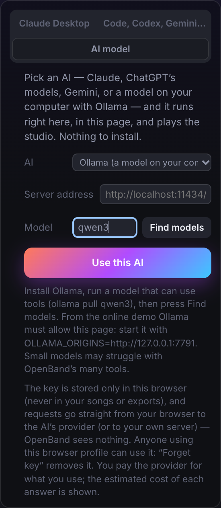

# Usare OpenBand con qualsiasi AI

🇬🇧 [English](AI-MODELS.md) · 🇮🇹 Italiano · [← README](../README.it.md)

OpenBand non è legato a una sola AI. Lo studio parla il protocollo aperto
[Model Context Protocol](https://modelcontextprotocol.io) (MCP) con le app AI, e la sua chat nella pagina
può usare Claude, i modelli di OpenAI, Gemini, oppure un modello sul tuo computer con Ollama. Ogni AI
riceve gli stessi 180 strumenti (175 nella pagina, dove non ci sono file né flusso di eventi).

**Strumenti a livelli**, così i modelli piccoli e locali non ne sono sommersi: la chat nella pagina inizia
ogni conversazione con i **29 strumenti core e capability** (la canzone, tracce, regioni e note, il
trasporto, annulla, la struttura, e uno strumento per ogni tipo di lavoro musicale: `create`, `transform`,
`suggest_continuation`, `mix_pilot`, `arrange_from_energy`, `export_for_platforms`, `set_jam_mode`),
aggiunge i gruppi che le tue parole chiedono in modo evidente (*"mixa"* → mix, *"il testo"* → lyrics), e il
modello carica gli altri con `load_toolset` (editing, structure, mix, analysis, recording, versions,
lyrics, plugins, sounds, files, collab, jam, engines): compaiono al turno successivo. Le app AI via MCP
ricevono tutti gli strumenti, come prima; avvia il server con `--toolsets=core` (o `OPENBAND_TOOLSETS=core`)
per avere i livelli anche lì: il client viene avvisato quando gli strumenti cambiano (`tools/list_changed`).

| AI | Nella pagina (la tua chiave) | App AI sul computer (MCP) | Sul web (MCP remoto) |
|---|---|---|---|
| **Claude** | ✓ chiave Anthropic | Claude Desktop, Claude Code | claude.ai |
| **OpenAI / ChatGPT** | ✓ chiave OpenAI (GPT-6.x) | Codex (CLI e IDE) | modalità sviluppatore di ChatGPT¹ |
| **Gemini** | ✓ chiave Gemini | Gemini CLI | — |
| **Ollama, LM Studio…** | ✓ senza chiave, sul tuo computer | Hermes Agent (con qualsiasi modello, anche locale) | — |
| **Altre** | qualsiasi server compatibile OpenAI | Cursor, VS Code, qualsiasi client MCP | qualsiasi client di server MCP remoti |

¹ Non ancora provato con ChatGPT: è lo stesso server MCP remoto che usa claude.ai, quindi dovrebbe
funzionare; [segnalacelo](https://github.com/iltempe/openband/issues) se non va.

## Nella pagina: scegli un'AI



Apri lo studio ([demo online](https://iltempe.github.io/openband/), l'app desktop o `npx`) → pannello
**AI** → scheda **Modello AI**. Scegli l'AI e il modello, incolla la tua chiave (per Ollama non serve) e
scrivi: l'AI suona lo studio con gli stessi strumenti che ha via MCP, ogni richiesta è un solo passo di
annullamento, il costo stimato di ogni risposta è indicato e *Stop* c'è sempre.

- **Le chiavi** restano nella memoria del browser, mai nelle canzoni o negli export; le richieste vanno
  dal browser direttamente al fornitore. *Dimentica chiave* la cancella, *Cambia AI* passa a un'altra
  (la conversazione allora ricomincia: un'AI non sa leggere i messaggi di un'altra).
- **OpenAI** usa la Responses API (`api.openai.com`), senza salvare nulla presso OpenAI (`store: false`).
  Chiave su [platform.openai.com/api-keys](https://platform.openai.com/api-keys).
- **Gemini** usa l'endpoint compatibile OpenAI di Google (`generativelanguage.googleapis.com/v1beta/openai`).
  Chiave su [aistudio.google.com/apikey](https://aistudio.google.com/apikey).
- **I prezzi** indicati sono quelli di listino di ottobre 2026 (quelli di Gemini sono promozionali e
  raddoppiano nel 2027): sono stime, conta la fattura del fornitore.

### Un modello sul tuo computer: Ollama

1. Installa [Ollama](https://ollama.com) e scarica un modello che sa usare gli strumenti, per esempio
   `ollama pull qwen3` (altri: `llama3.1`, `mistral-small`, `gpt-oss`).
2. Dagli spazio per gli strumenti di OpenBand (circa 8.000 token): avvia Ollama con un contesto più
   ampio, per esempio `OLLAMA_CONTEXT_LENGTH=32768 ollama serve`.
3. Nella scheda **Modello AI** scegli *Ollama*, premi *Trova i modelli*, scegline uno, *Usa questa AI*.

Dall'**app desktop** o da uno studio avviato sul tuo computer (`npx …`, `http://127.0.0.1:7777`) basta
così. Dalla **demo online** Ollama deve anche consentire la pagina: avvialo con
`OLLAMA_ORIGINS=https://iltempe.github.io` (su macOS: `launchctl setenv OLLAMA_ORIGINS https://iltempe.github.io`
e riavvia Ollama); quando il browser chiede di consentire al sito l'accesso alla rete locale, scegli *Consenti*.

I modelli locali piccoli sono gratuiti e privati, ma faticano con una lunga lista di strumenti:
aspettati canzoni più semplici e più tentativi rispetto ai grandi modelli in cloud.

**Altri server**: scegli *Other OpenAI-compatible server* e indica l'indirizzo: LM Studio
(`http://localhost:1234/v1`), vLLM, il server di llama.cpp, oppure un servizio online come OpenRouter
(`https://openrouter.ai/api/v1`, con la sua chiave). Su un OpenBand self-hosted con
Content-Security-Policy, i servizi online diversi da Anthropic, OpenAI e Google vanno aggiunti a
`connect-src` (`server/csp.mjs`).

## App AI sul tuo computer (MCP)

`npx -y --allow-remote=all https://github.com/iltempe/openband/releases/latest/download/openband.tgz setup`
(oppure, nell'app desktop, *App AI → Aggiungi OpenBand alle mie app AI*) trova e configura Claude
Desktop, Claude Code, **Codex**, **Gemini CLI**, **Hermes Agent**, Cursor e VS Code. A mano:

**Codex** (la CLI e l'estensione IDE di OpenAI), `~/.codex/config.toml`:

```toml
[mcp_servers.openband]
command = "npx"
args = ["-y", "--allow-remote=all", "https://github.com/iltempe/openband/releases/latest/download/openband.tgz", "mcp"]
```

oppure `codex mcp add openband -- npx -y --allow-remote=all https://github.com/iltempe/openband/releases/latest/download/openband.tgz mcp`.

**Gemini CLI**, `~/.gemini/settings.json`:

```json
{
  "mcpServers": {
    "openband": { "command": "npx", "args": ["-y", "--allow-remote=all", "https://github.com/iltempe/openband/releases/latest/download/openband.tgz", "mcp"] }
  }
}
```

**Hermes Agent** (Nous Research), `~/.hermes/config.yaml` (o `$HERMES_HOME/config.yaml`), poi
`/reload-mcp` in una chat di Hermes:

```yaml
mcp_servers:
  openband:
    command: "npx"
    args: ["-y", "--allow-remote=all", "https://github.com/iltempe/openband/releases/latest/download/openband.tgz", "mcp"]
```

Poi chiedi: *“crea un beat lo-fi a 82 BPM in Re minore con batteria, basso e Rhodes, poi mettilo in
loop”*. La prima chiamata di uno strumento apre lo studio nel browser (o nell'app desktop). Altro in
[CONNECT.it.md](CONNECT.it.md).

## Sul web: claude.ai e ChatGPT (MCP remoto)

Un OpenBand self-hosted avviato con `OPENBAND_REMOTE_MCP=1` serve MCP via HTTPS su `/mcp`
([come](SELF-HOSTING.it.md#claudeai-come-client-mcp-remoto)). Aggiungi `https://tuo-host/mcp?token=<token>`:

- in **claude.ai**: *Impostazioni → Connettori → Aggiungi connettore personalizzato*;
- in **ChatGPT**: attiva la *modalità sviluppatore* (Impostazioni → App / Connettori → Avanzate; piani
  Plus, Pro, Business, Enterprise ed Edu) e crea un connettore con quell'URL, senza autenticazione.

Poi apri lo studio → **AI** → scheda *claude.ai, ChatGPT* e dai all'AI il codice di 6 cifre che mostra.
