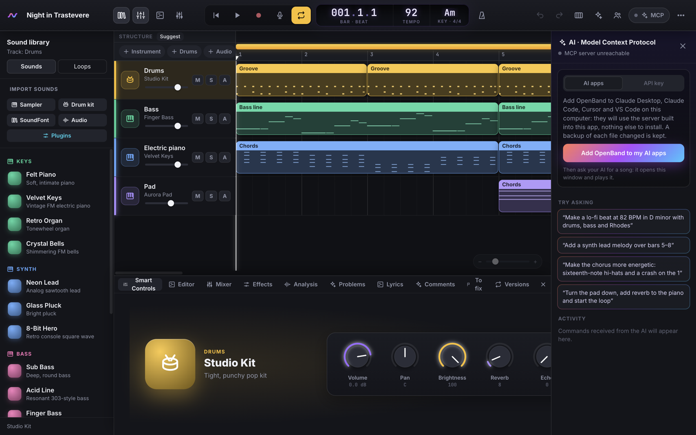
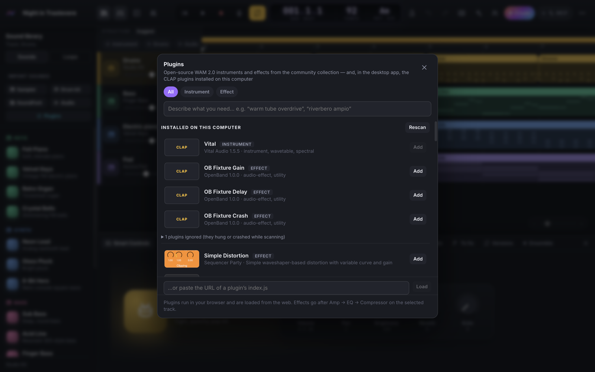
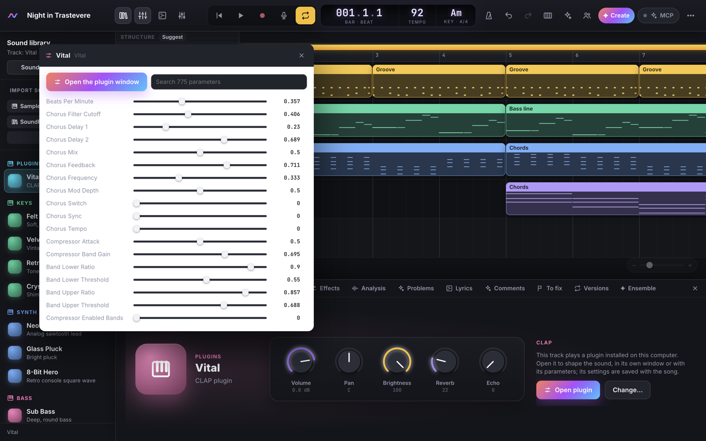

# L'app desktop di OpenBand

🇬🇧 [English](DESKTOP.md) · 🇮🇹 Italiano · [← README](../README.it.md)

Lo stesso studio della [demo online](https://iltempe.github.io/openband/), in una finestra sua, per macOS,
Windows e Linux, con il server MCP incluso: niente browser, niente Node, niente comandi.



## Scaricala

| Sistema | File |
|---|---|
| macOS, Apple Silicon (M1 e successivi) | [OpenBand-mac-arm64.dmg](https://github.com/iltempe/openband/releases/latest/download/OpenBand-mac-arm64.dmg) |
| macOS, Intel | [OpenBand-mac-x64.dmg](https://github.com/iltempe/openband/releases/latest/download/OpenBand-mac-x64.dmg) |
| Windows 10 e 11 (x64) | [OpenBand-win-x64.exe](https://github.com/iltempe/openband/releases/latest/download/OpenBand-win-x64.exe) |
| Windows su ARM | [OpenBand-win-arm64.exe](https://github.com/iltempe/openband/releases/latest/download/OpenBand-win-arm64.exe) |
| Linux (Ubuntu, Debian…) | [OpenBand-linux-amd64.deb](https://github.com/iltempe/openband/releases/latest/download/OpenBand-linux-amd64.deb) · [AppImage](https://github.com/iltempe/openband/releases/latest/download/OpenBand-linux-x86_64.AppImage) (anche `arm64`) · [Flatpak](https://github.com/iltempe/openband/releases/latest/download/OpenBand-linux-x86_64.flatpak) (dalla v0.6.35, vedi [flatpak/README.md](../flatpak/README.md)) |

Tutti i file sono nella [pagina delle release](https://github.com/iltempe/openband/releases/latest).

## La prima apertura

L'app non è ancora firmata (la firma costa un abbonamento annuale ad Apple e un certificato per Windows),
quindi il sistema ti chiede una conferma, una volta sola:

- **macOS**: apri il `.dmg` e trascina OpenBand in *Applicazioni* (l'immagine disco contiene anche
  questi passaggi, in *Se non si apre*). Fai doppio clic su OpenBand: macOS dice *«OpenBand.app» non è
  stata aperta… Apple non è in grado di verificare…* — premi *Fine*. Poi *Impostazioni di Sistema →
  Privacy e sicurezza*, scorri fino a *«OpenBand.app» è stata bloccata* e premi **Apri comunque**,
  confermando con la password. Da lì in poi si apre normalmente. (Da macOS 15 il clic destro → *Apri*
  non basta più.) Lo stesso con un solo comando nel Terminale:
  `xattr -dr com.apple.quarantine /Applications/OpenBand.app`. L'app non è rotta: macOS blocca ogni app
  scaricata che non sia notarizzata da Apple, cosa che richiede un account sviluppatore a pagamento.
- **Windows**: avvia l'installer; se SmartScreen dice *PC protetto da Windows*, fai clic su *Ulteriori
  informazioni* → *Esegui comunque*.
- **Linux**: `sudo apt install ./OpenBand-linux-amd64.deb`, oppure rendi eseguibile l'AppImage
  (`chmod +x OpenBand-*.AppImage`) e avviala. Da Ubuntu 24.04 in poi l'AppImage potrebbe non partire
  per le regole di sandbox di AppArmor: usa il `.deb`, oppure avviala con `--no-sandbox`.

## Aggiornamenti

*⋯ → Informazioni su OpenBand* (o *About OpenBand* nel menu dell'app) mostra la versione che hai e cerca
quella nuova; all'avvio l'app controlla una volta al giorno e, se c'è, mostra una notifica di sistema.
**Aggiorna ora** scarica dall'ultima release il pacchetto per il tuo computer, lo verifica con lo SHA-256 che
GitHub pubblica, lo installa e riavvia OpenBand da solo: su macOS sostituisce l'app, su Windows l'installer
gira in silenzio, l'AppImage viene sostituita; un `.deb` si apre nell'installer di sistema (installarlo
richiede la tua password). Un Flatpak lo aggiorna Flatpak. Brani e impostazioni restano. Vale dalla
v0.6.35 in poi: le versioni precedenti si aggiornano a mano una volta.

## Collega la tua AI

Apri il pannello **AI** → **App AI** → *Aggiungi OpenBand alle mie app AI* (oppure *File → Connect to
Claude and other AI apps…*). L'app si aggiunge a Claude Desktop, Claude Code, Cursor e VS Code dove li
trova, tenendo una copia di backup di ogni file che modifica. Riavvia Claude Desktop e chiedi una
canzone: lo studio si apre nell'app.

Come funziona: l'app AI avvia l'eseguibile di OpenBand in modalità Node sul server MCP incluso
nell'app (`server/mcp-server.mjs`, lo stesso di `npx` e del `.mcpb`) e, quando quel server ha bisogno
dello studio, apre l'app invece del browser. Su macOS sposta l'app in *Applicazioni* prima di
collegarla: le app AI ricordano dove si trova. Usa l'app oppure l'estensione per Claude Desktop
(`.mcpb`), non entrambe: aggiungerebbero entrambe gli strumenti di OpenBand.

## Cosa cambia rispetto al browser

- **File**: i file `.openband`, `.mid` e `.dawproject` si aprono con un doppio clic, da *File → Open*
  (⌘O / Ctrl+O) e da *Open Recent*; salvataggi ed esportazioni chiedono dove mettere il file.
- **Menu**: *File* (nuova canzone, apri, salva, esporta WAV / MIDI / DAWproject, collega le app AI),
  *Edit*, *View*, *Window*, *Help* (per ora in inglese). Le scorciatoie dello studio funzionano come nel
  browser.
- **Le canzoni** stanno nella memoria dell'app, separata da quella del browser: per spostare una canzone
  tra i due, salvala come `.openband` e aprila dall'altra parte.
- **Aggiornamenti**: una volta al giorno l'app controlla su GitHub se c'è una nuova versione, te lo dice
  con una notifica e si aggiorna da sola da *Informazioni su OpenBand* (vedi [Aggiornamenti](#aggiornamenti)). Le canzoni restano.
- **Plugin**: i plugin web (WAM) funzionano come nel browser. I plugin nativi VST3 / CLAP / AU si
  costruiscono per fasi ([SPEC v0.6, G8](SPEC-v0.6.md), [ADR 0001](adr/0001-desktop.md)); vedi
  [Plugin nativi](#plugin-nativi) qui sotto.

## Plugin nativi

Gli **strumenti e gli effetti CLAP, VST3 e Audio Unit** installati sul computer funzionano nell'app: *Plugin* (nella libreria, o *+ Plugin*
negli effetti di una traccia) li elenca in *Installati su questo computer*, accanto ai plugin web. OpenBand
li cerca nelle cartelle standard: CLAP in macOS `~/Library/Audio/Plug-Ins/CLAP` e `/Library/Audio/Plug-Ins/CLAP`,
Windows `Common Files\CLAP`, Linux `~/.clap`, `/usr/lib/clap`; VST3 in macOS `~/Library/Audio/Plug-Ins/VST3` e
`/Library/Audio/Plug-Ins/VST3`, Windows `Common Files\VST3`, Linux `~/.vst3`, `/usr/lib/vst3`. Su Mac, gli Audio
Unit sono quelli che il sistema conosce (come in Logic o GarageBand), compresi quelli di Apple. Le esamina un plugin alla volta, ognuno in un processo a
parte: uno che si blocca o si chiude durante la ricerca viene messo da parte (*Ignorati*, con *Riprova*). Un plugin ha 60 s per la scansione e 120 s per il caricamento, perché gli strumenti pesanti come Analog
Lab o le grandi librerie campionate la prima volta ci mettono molto. Se il tempo scade, OpenBand lo esamina
prima di fermarlo e dice perché:
- **stava ancora lavorando**: occupato a caricare la sua libreria, e *Riprova* gli dà il triplo del tempo;
- **era fermo in attesa**: di solito una finestra di attivazione o di licenza, e per Arturia, Native
  Instruments, Waves, iLok e altri indica quale app aprire (Arturia Software Center, Native Access…);
- **compilato per l'altra CPU**: un plugin solo Intel su Apple Silicon o viceversa, rifiutato subito con il
  motivo.

`OPENBAND_PLUGIN_TIMEOUTS="scansione,caricamento,finestra"` (in secondi) cambia i limiti.
Ogni plugin mostra il suo formato (CLAP, VST3, AU); un plugin installato in più formati compare una volta per
formato: va bene uno qualsiasi, e tutto quello che segue vale per tutti.



- **Ogni plugin gira in un processo suo** (`openband-plughost`): se va in crash, si ferma solo lui. La
  traccia continua a suonare senza, a tempo, lo slot dice *Si è chiuso*, e **Riavvia** lo riapre con lo
  stato salvato nella canzone.
- **A tempo con tutto il resto**: l'audio va al plugin e torna a blocchi, circa 16 ms più la latenza del
  plugin, e OpenBand ritarda altrettanto le altre tracce (compensazione della latenza), dal vivo e negli
  export. Lo slot mostra la latenza.
- **Strumenti**: aggiungine uno da *Plugin* (su una traccia nuova, o sulla traccia strumento da cui hai
  aperto la finestra); suona le note della timeline, una tastiera MIDI e le parti dell'AI. **Modifica** (o
  *Apri plugin* negli Smart Controls) mostra i suoi parametri, con la ricerca, e **Apri la finestra del
  plugin** apre la sua interfaccia, sospesa sopra lo studio (macOS e Windows; su Linux per ora i parametri).
- L'**automazione** di qualsiasi parametro arriva sul campione esatto dentro il blocco audio, e muovere un
  controllo nella finestra del plugin viene registrato in Touch / Latch come qualsiasi manopola dello
  studio. Ogni modifica nella finestra del plugin è un passo di annullamento, e le impostazioni si salvano
  con la canzone.



- **Monitoraggio a bassa latenza**: quando suoni una traccia con uno strumento nativo (quella selezionata),
  l'host dei plugin apre lui stesso l'uscita audio con un buffer piccolo (128 campioni, circa 2,7 ms ×2 a
  48 kHz) e le note della tastiera gli arrivano direttamente: senti solo la latenza del dispositivo, non i
  ~16 ms del bridge. Gli Smart Controls mostrano *Monitoraggio a bassa latenza attivo*, il dispositivo e il
  tempo dall'ultimo tasto al suono. Il resto della canzone suona come sempre; anche le note della traccia
  sulla timeline suonano lì, a tempo. Finché è attivo valgono il fader e il pan della traccia, non gli
  altri effetti né la catena del master. Spegnilo con l'interruttore per sentire tutta la catena.

- I plugin sono programmi che girano con i tuoi permessi: OpenBand lo dice prima del primo, e li carica
  solo dalle cartelle dei plugin, mai da internet.
- Gli **export** includono i plugin nativi: l'export li fa girare nella loro modalità offline, blocco per
  blocco attraverso il loro host; due export della stessa canzone sono identici al bit, e suonano come
  quello che hai sentito.
- **Le canzoni viaggiano**: quando salvi una canzone come `.openband`, ogni traccia che suona un plugin
  nativo tiene il suo audio "congelato" dentro il file. Aperta nel browser, nello studio online o su un
  computer senza quel plugin, la traccia suona l'audio congelato (**❄ Congelata** accanto al nome) e puoi
  comunque mixarla; se lì cambi le sue note, il badge dice **Non aggiornata**: apri la canzone nell'app
  desktop per congelarla di nuovo, o clicca il badge per scegliere un altro strumento.
- **Effetti MIDI** (un orchestratore come Texturium, un arpeggiatore; VST3, AU MIDI FX, effetti di nota CLAP) compaiono tra gli strumenti: mettine uno su una traccia e suonalo, e quello che suona va alle tracce in ascolto sui suoi canali (Smart Controls → *Ingresso MIDI*: il suo nome come dispositivo). Solo dal vivo: registra le parti per esportarle.
- Prossimi passi: finestre native su Linux; gli Audio Unit v3 che girano solo come estensioni di app non sono ancora provati.

## Compilarla

```bash
npm ci && npm ci --prefix desktop   # gli strumenti di build dell'app (Electron) stanno in desktop/
npm run build                       # lo studio
npm run desktop:dev                 # avvia l'app dal checkout (profilo "OpenBand (dev)")
npm run desktop:build               # installer per questo sistema in build/desktop/ (--dir: solo l'app)
npm run desktop:smoke               # prova l'app: suona, e un client MCP la comanda
```

Il workflow *Release* costruisce gli installer su macOS, Windows e Linux e li aggiunge alla release su
GitHub. Per firmarli più avanti, aggiungi i secret `CSC_LINK` (il certificato, in base64) e
`CSC_KEY_PASSWORD`; su macOS la notarizzazione richiede anche `APPLE_ID`, `APPLE_APP_SPECIFIC_PASSWORD` e
`APPLE_TEAM_ID` (vedi la guida alla firma di electron-builder).
