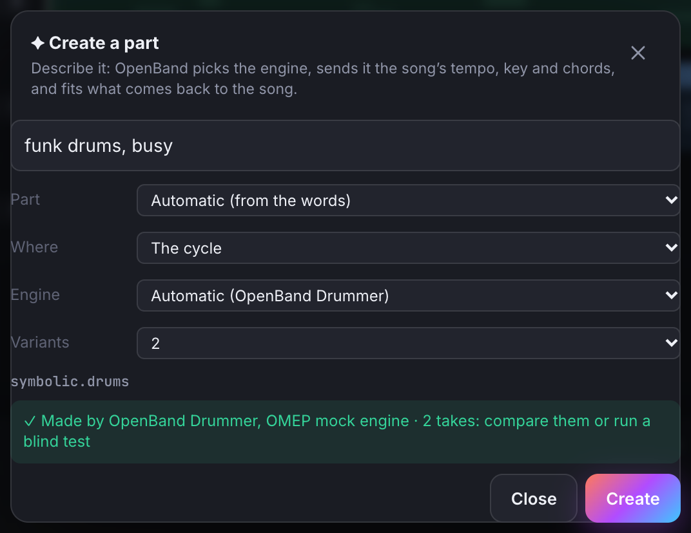
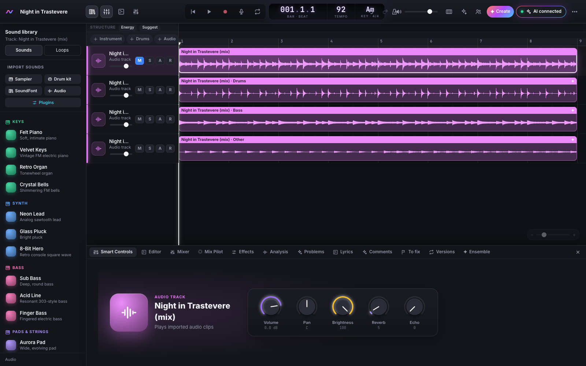

# Ensemble: i motori che suonano in OpenBand

🇬🇧 [English](ENSEMBLE.md) · 🇮🇹 Italiano · [← README](../README.it.md)

OpenBand è dove vive la canzone; i **motori** ne suonano le parti. Un motore può essere uno degli algoritmi
di OpenBand, un modello musicale nel tuo browser o sul tuo computer, uno su un altro computer della tua rete
o un servizio online. Parlano tutti lo stesso standard aperto, l'[Open Music Engine Profile](../omep/README.md)
(OMEP), quindi OpenBand non chiama mai un modello per nome: tu chiedi una parte, OpenBand sceglie chi la
suona.

## Crea una parte

Premi **✦ Crea** nella barra (oppure *Ensemble → Crea una parte*), descrivi cosa vuoi — *«batteria funk,
fitta»*, *«piano arpeggiato, intimo»*, *«un loop di tastiere lo-fi»* — e scegli dove (tutta la canzone, il
ciclo, una sezione, alcune battute). OpenBand:

1. capisce la **parte**: batteria (note), accompagnamento (note) o uno strato audio, dalle tue parole
   oppure scegli tu;
2. sceglie il **motore** con il router (vedi sotto), o quello che indichi;
3. gli manda il **contesto** della canzone: tempo, tonalità, sezioni, gli accordi che legge dalle tue parti,
   solo quello che quel motore dichiara di usare;
4. **adatta** quello che torna alla canzone: note nella tonalità e nell'estensione della canzone e dentro le
   battute; audio portato al tempo, spostato nella tonalità, ripetuto o tagliato sulle battute. Ogni
   correzione è scritta (*«stretch 12.2% (82 → 92 BPM) · repeated ×4»*);
5. la mette nella canzone come **un solo passo di annullamento**. Con le **varianti** (fino a 4, da motori
   diversi quando più d'uno può suonare) i risultati diventano take di una regione: confrontale, o fai un
   test alla cieca.



Non serve un'AI. Se ce n'è una collegata, può fare lo stesso con lo strumento `create`.

## I motori

| Motore | Parte | Dove | Licenza |
|---|---|---|---|
| **OpenBand Drummer** | batteria (10 stili, segue le sezioni) | in OpenBand | MIT |
| **OpenBand Chords** | accompagnamento: accordi tenuti, stab o arpeggio, sugli accordi della canzone | in OpenBand | MIT |
| **OpenBand CC0 loops** | uno strato audio dalla libreria di loop CC0 | in OpenBand | MIT + audio CC0 |
| **Demucs nel browser** | stem: batteria, basso, altro, voce | nel tuo browser | MIT (codice e pesi) |
| i tuoi motori | quello che dichiarano | il tuo computer, la tua rete | la loro |

### Aggiungere motori

I motori che installi girano tramite il server OpenBand sul tuo computer: l'app desktop, `npx …` o
l'estensione per Claude Desktop. Elencali in `~/.openband/engines.json` (oppure indica un altro file con
`OPENBAND_ENGINES`), nello stesso formato dei client MCP:

```json
{
  "engines": {
    "ace-step":  { "command": "uvx", "args": ["omep-ace-step"], "env": { "DEVICE": "cuda" } },
    "studio-pc": { "url": "https://192.168.1.20:8765/mcp", "token": "…" },
    "mock":      { "builtin": "omep-mock" }
  }
}
```

poi premi *Aggiorna* in *Ensemble*. OpenBand avvia solo quello che c'è in quel file. `"builtin": "omep-mock"`
è il motore di riferimento del repository OMEP, utile per provare tutta la catena. Prima di installare un
motore, controllalo con `openband omep-conformance -- <il suo comando>`.

## Le tue regole e il router

*Ensemble → Le tue regole*:

- **Solo uso commerciale** (attivo di default): non si usano i motori la cui licenza (del codice, dei pesi
  o, online, dell'output) vieta l'uso commerciale. I motori con licenza *condizionata* chiedono una volta.
- **Solo motori su questo computer**: niente passa dalla rete.
- **Consenti i motori online** (disattivato di default): costano e inviano dati al fornitore.

Tra i motori rimasti, il router preferisce quelli che rispettano meglio le canzoni (l'aderenza misurata
dalla conformità e dalle correzioni che OpenBand ha dovuto fare), poi i più veloci; i motori di OpenBand
vengono prima, salvo che un altro faccia meglio. Ogni motore escluso è elencato con il motivo.

## Motori online (senza GPU)

Anche i modelli musicali ospitati da **fal.ai** funzionano come motori, con lo stesso router, la stessa
conformità e lo stesso registro, al prezzo di fal (ACE-Step: circa 0,0002 USD al secondo di musica, quindi
uno strato di 30 secondi costa circa 0,006 USD; separazione degli stem con Demucs: 0,0007 USD al secondo).
I modelli sono elencati in `omep/fal-catalog.json`; aggiungerne uno è aggiungere una voce lì.

- **Con l'app desktop o il server locale**: metti la tua chiave fal in `~/.openband/engines.json`, non
  lascia mai il tuo computer:
  ```json
  { "engines": { "fal-ace-step": { "builtin": "omep-fal", "model": "ace-step", "env": { "FAL_KEY": "…" } } } }
  ```
- **Nello studio online**: pubblica un tuo **relay** (un Cloudflare Worker o una funzione Vercel gratuiti,
  pochi minuti: [deploy/relay](../deploy/relay/README.md)); tiene lui la chiave, la pagina conosce solo
  l'indirizzo del relay e il tuo token. Poi *Ensemble → Motori online*: il relay, e i modelli compaiono.

Prima di ogni esecuzione vedi un **preventivo** (*"Circa 0,0032 USD (1 × ACE-Step on fal), dal tuo
budget"*); imposta un **budget per sessione e al mese**: oltre, nulla di online parte senza il tuo ok (l'AI
deve chiedertelo e poi riprovare con `confirm_spend`). Quanto è costato ogni motore resta registrato. Ogni
motore online dice cosa invia (solo testo, o l'audio della canzone), cosa conserva il fornitore, se gli
input servono all'addestramento, i termini e quando sono stati verificati; i termini di fal sull'output
sono *condizionati*, quindi li accetti una volta per motore. OpenBand porta anche quello che un motore
restituisce a un livello di lavoro (−20 dBFS RMS, come guadagno della regione) e non inserisce audio muto
o fatto solo di rumore; il clipping viene segnalato.

## Separare gli stem

Seleziona una regione audio e premi **Separa gli stem** nel suo editor (o chiedilo all'AI: `separate`).
OpenBand mette **batteria, basso, altro e voce** su tracce proprie, subito sotto l'originale, che viene
silenziato — mai rimosso — e tutto è un solo passo di annulla. Gli stem vuoti (una canzone senza voce) non
vengono creati.



Gira **nel tuo browser** con [HT-Demucs](https://github.com/facebookresearch/demucs) (Meta, MIT): gratis,
privato — l'audio non lascia il tuo computer — e offline. Il modello (166 MB,
l'[export ONNX di StemSplit](https://huggingface.co/StemSplitio/htdemucs-onnx), MIT) si scarica **una volta,
quando dai l'ok**, da Hugging Face; OpenBand lo verifica col suo SHA-256 e lo tiene nel browser
(*Ensemble → Separazione degli stem* lo mostra e lo rimuove). Ci mette da due a tre volte la durata
dell'audio su un computer normale, in background. Con i motori online attivi può farlo anche Demucs su fal,
al suo prezzo; quello nel browser viene sempre provato per primo.

**Uno strato che torna come mix intero.** Alcuni motori audio, a cui chiedi un solo strato nuovo,
rispondono col mix completo: la tua canzone più la parte nuova. OpenBand separa la risposta e le stesse
battute della tua canzone in stem, tiene gli stem in cui la risposta ha qualcosa che la canzone non ha (una
differenza spettrale, stem per stem) e sottrae quello che è ancora la tua canzone: la parte nuova arriva da
sola sulla sua traccia, e la correzione dice quali stem ha tenuto (*"isolated the new part from the full
mix: kept other 82 % new; dropped drums, bass"*).

## Chi ha suonato cosa

Ogni parte fatta da un motore ha una ✦ sulla regione e una voce nel **registro dei contributi**: motore,
versione, seed, licenza, la tua richiesta, il contesto da cui è nata (un hash della canzone) e le correzioni.
*Ensemble → Chi ha suonato cosa* mostra la quota umano / AI di ogni traccia: una regione conta come AI
finché la take attiva è del motore; registra o scrivi una tua take e sceglila, e torna tua. Il registro
viaggia dentro la canzone (`.openband`, export) e servirà per crediti e dichiarazione AI in pubblicazione.

## Per i client AI

`create` (descrivi la parte; `variants`, `engine` solo se richiesto), `separate` (una regione audio in stem; `confirm_download` solo dopo l'ok dell'utente al download una tantum), `list_engines` (motori, percorsi ed
esclusioni secondo le regole), `get_ledger` (contributi e quote), `set_engine_policy`.
