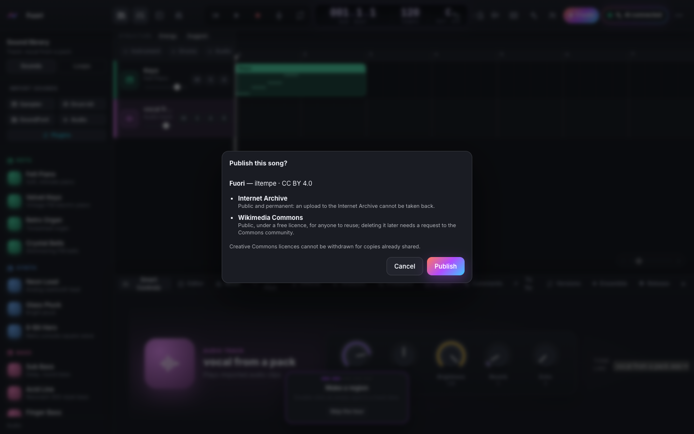

# Pubblicare un brano

Tutto si fa nella scheda **Pubblica**, in basso nello studio. Un'IA può fare lo stesso con gli strumenti del
toolset `release` ([MCP-TOOLS.it.md](MCP-TOOLS.it.md)), ma non pubblica mai da sola: ogni pubblicazione
aspetta il tuo clic.

## 1. Prepara il brano
- **Il brano**: titolo, artista, genere, tag, data, contatto, descrizione.
- **Licenza**: rispondi alle tre domande (uso commerciale? modifiche? stessa licenza per le modifiche?) oppure
  dona il brano al pubblico dominio. Le licenze Creative Commons non si possono revocare per le copie già
  distribuite. Se sei iscritto a una società di gestione (SIAE, PRS, ASCAP…), verifica con lei prima di
  sceglierne una.
- **Cosa contiene il brano**: dai a ogni campione importato la sua licenza. Un campione la cui licenza non
  permette quella del brano viene nominato, qui e in *Problemi*, e blocca la pubblicazione.
- **Copertina**: generane una (stile, palette, *Un'altra*), o usa una tua immagine.
- **Release Kit** e **Crea il video**: i file da caricare a mano ovunque.

## 2. Configura i tuoi account
Per pubblicare serve l'**app desktop di OpenBand o `npx openband`** sul tuo computer. Chiavi e accessi restano
lì, in `~/.openband/publish.json`, leggibile solo da te. Non sono mai nella pagina web e non passano mai da
un'IA. Nello studio online usa il Release Kit.

**Internet Archive**: apri [archive.org/account/s3.php](https://archive.org/account/s3.php) da loggato,
copia le chiavi *access* e *secret* in *Pubblica → Account → Internet Archive* e salva.

**Wikimedia Commons**, in uno dei due modi:
- **Consumer solo per te** (il più rapido; vale solo per il tuo account). Proponi un consumer OAuth 2.0 su
  [Special:OAuthConsumerRegistration](https://meta.wikimedia.org/wiki/Special:OAuthConsumerRegistration/propose/oauth2)
  e spunta l'opzione per l'uso solo da parte tua. Come permesso scegli *Caricare nuovi file*. Incolla
  l'**access token** che ti mostra in *Account → Wikimedia Commons*.
- **Consumer normale** (va approvato da Wikimedia). Proponine uno con lo stesso permesso, togli la spunta
  a *client confidenziale* e registra l'**URL di reindirizzamento** mostrato in *Account*
  (`http://127.0.0.1:<porta>/publish/oauth/callback`). Una volta approvato, incolla la sua chiave e premi
  **Accedi**. Si apre una finestra di Wikimedia; dopo che hai autorizzato, OpenBand conserva l'accesso
  (OAuth 2.0 con PKCE) e lo rinnova quando scade.

**SoundCloud**: crea un'app su [soundcloud.com/you/apps](https://soundcloud.com/you/apps) con l'**URL di
reindirizzamento** mostrato in *Account* (`http://127.0.0.1:<porta>/publish/oauth/callback`), incolla client
ID e secret e premi **Accedi**.

**YouTube**: nella [console di Google Cloud](https://console.cloud.google.com/apis/credentials) abilita la
*YouTube Data API v3*, configura la schermata di consenso OAuth (aggiungi te stesso come utente di test) e crea
un client OAuth di tipo **App desktop**. Incolla client ID e secret e premi **Accedi**. Ogni caricamento usa
quota dell'API: circa 100 video al giorno per progetto.

**Mixcloud**: crea un'app su [mixcloud.com/developers](https://www.mixcloud.com/developers/create/) con l'URL
di reindirizzamento mostrato in *Account* (finisce con `/callback/mixcloud`), incolla client ID e secret e
premi **Accedi**.

L'URL di reindirizzamento contiene la porta che usa l'OpenBand locale (7777, se non era occupata): registra
quello che mostra *Account*.

## 3. Pubblica
Spunta le piattaforme (*Pubblica in CC* spunta quelle permesse dalla tua licenza) e premi **Pubblica…**. Lo
studio ricontrolla tutto e ti chiede conferma:
- **Internet Archive**: un item in *Community Audio* con il master in FLAC a 24 bit (tag e copertina
  dentro), la copertina, l'LRC, LICENSE.txt e CREDITS.txt. I metadati includono l'URL della licenza.
  L'item è **pubblico e permanente**.
- **Wikimedia Commons**: il master in FLAC, caricato a pezzi (uno fallito viene rimandato). La pagina di
  descrizione contiene `{{Information}}` e il template della licenza (`{{cc-zero}}`, `{{cc-by-4.0}}` o
  `{{cc-by-sa-4.0}}`). Commons accetta solo licenze libere: con NC o ND è disattivato.

- **SoundCloud**: il master in FLAC con la copertina come artwork, la licenza nei termini di SoundCloud (tutte
  le Creative Commons), genere e tag; *pubblico*, oppure *privato* (un link privato) per il resto.
- **YouTube**: il video 16:9 creato nello studio (copertina, spettro, testo), caricato a pezzi che riprendono
  dopo una connessione caduta; *pubblico*, *non in elenco* o *privato*; licenza *Creative Commons* per CC BY,
  quella standard altrimenti; i *contenuti alterati o sintetici* vengono dichiarati quando motori di IA hanno
  fatto parte del brano (dal suo registro).
- **Mixcloud**: un MP3 a 320 kbit/s con la copertina, al massimo 5 tag; sempre pubblico.

Scegli *Pubblico*, *Non in elenco* o *Privato* accanto a **Pubblica…**: vale per YouTube e SoundCloud.

Cosa è uscito, dove, quando e quale master restano nel brano (*Pubblicato*, `get_publications`).

**In arrivo**: Audius e Funkwhale.
Spotify, Apple Music e gli altri store richiedono un distributore e non hanno un'API di upload aperta, quindi OpenBand lì non pubblica.
