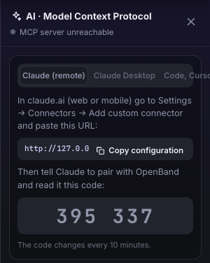

# Host your own OpenBand

🇬🇧 English · 🇮🇹 [Italiano](SELF-HOSTING.it.md) · [← README](../README.md)

The studio is a static app, so it runs anywhere — for a school, a community or just yourself:

[](https://app.netlify.com/start/deploy?repository=https://github.com/iltempe/openband) [](https://vercel.com/new/clone?repository-url=https://github.com/iltempe/openband)

- **GitHub Pages from your fork:** fork → *Settings → Pages → Source: GitHub Actions* → *Settings → Secrets and variables → Actions → Variables*: `OPENBAND_DEPLOY = true`. Forks don't deploy until you opt in.
- **Cloudflare Pages:** connect the repository with the *Vite* preset (build `npm run build`, output `dist`), or `wrangler pages deploy dist`.
- **Docker** (NAS, Raspberry Pi, a school server; amd64 and arm64): from a clone, `docker compose up -d --build` with the included `docker-compose.yml`, or `docker build -t openband . && docker run -p 8080:7777 openband` (multiplayer rooms on, healthcheck on `/version.json`).
- **Settings without rebuilding:** put a `config.json` next to `index.html` (or point `OPENBAND_CONFIG` to one in Docker) — instance name, default language, features to turn off (the in-browser chat, plugins, rooms), plugin catalog URL, collaboration server. See [`config.example.json`](../config.example.json).
- Every host gets the same headers: assets cached forever, the page and the service worker never, and a Content-Security-Policy (`server/csp.mjs`) that lets the page reach only the bridge on the user's computer, the Anthropic API, the plugin catalog and the collaboration servers. A static instance stores nothing: songs stay in each visitor's browser. Cross-origin isolation (COOP/COEP, for future `SharedArrayBuffer` use) is not enabled yet.

## Project store

`openband start` and `openband mcp` keep a library of projects on disk (`~/.openband/library`, or `OPENBAND_DATA`), reachable under `/api/store/v1`. On a server that listens on the network, turn it on with `OPENBAND_STORE=1`.

- This computer needs no code. The LAN and allowed sites (`OPENBAND_ALLOWED_ORIGINS`) pair once with the code the server prints, and the browser keeps the token.
- From the internet, set `OPENBAND_STORE_TOKEN` as well: without it, requests from outside the LAN are refused. A request through a proxy or tunnel counts as coming from outside.
- `OPENBAND_STORE_QUOTA` limits the library in bytes (default: 80% of the free disk at start). Over it, new data is refused with a clear error and nothing is lost.
- A deleted project stays in `trash/` for 30 days. A backup is a copy of the folder.
- In the studio: **Projects → Archive**, enter the address and, if asked, the pairing code. *Move to the server* puts a song there with its versions and samples.
- The browser stays your working copy: offline you keep working, and changes leave when the network is back. A page on https can only reach an https server, so on a LAN open the studio from the server itself.
- If two devices change the same song, nothing is overwritten: your version lands on a branch `conflitto-<device>-<date>`, the open song becomes the server's, and the panel offers *Compare* and *Merge*.

## Play together

- **On the same network** (fastest): start the MCP server with `OPENBAND_COLLAB=1` — it then also serves the studio and a room relay on your LAN address (printed at start; the AI bridge itself stays reachable only from this computer). Open a room with *On this network* and send the link.
- **Peer to peer**: *Peer to peer* connects the browsers directly with WebRTC; the link opens the online demo. Peers find each other through a signaling server: OpenBand's own (`/signal` on a server started with `OPENBAND_COLLAB=1`) or y-webrtc's public one, and you can pass your own with `?signal=wss://…` (it travels with the link). Public signaling servers come and go, so for reliable sessions over the internet run one you control.
- A password encrypts peer-to-peer traffic and separates rooms with the same name; send it apart from the link.

## claude.ai as a client (remote MCP)

A self-hosted OpenBand started with `OPENBAND_REMOTE_MCP=1` also speaks MCP over Streamable HTTP at `/mcp`, so it can be added in claude.ai under *Settings → Connectors → Add custom connector* (also from a phone):

```
claude.ai ──HTTPS · MCP──▶ https://music.example/mcp ──WebSocket──▶ the user's OpenBand tab
```

1. Run it: `docker run -p 8080:7777 -e OPENBAND_REMOTE_MCP=1 -e OPENBAND_REMOTE_TOKEN=<a long random string> openband` (the image built above), behind HTTPS (Caddy, nginx… forwarding the `Host` header).
2. In claude.ai add the connector `https://music.example/mcp?token=<the token>`.
3. Open the studio → **AI** → *Claude (remote)* tab: the tab shows a 6-digit code. Tell Claude “pair with OpenBand, code 395 337” (or add `&pair=<code>` to the connector URL).



The server is only a relay and stores nothing: songs stay in the tab. Each MCP session drives the one tab it paired with — other tabs, even on the same server, are invisible to it — and no tool works before pairing (`pair_studio`). Codes change every 10 minutes and are spent once used; 5 wrong codes per session per minute (30 across all sessions) block pairing for a minute; tool calls are rate-limited per session (60 every 10 s) and idle sessions end after 30 minutes. In this mode files are imported only from public http(s) URLs (never local paths, and never addresses of the server's own network), and exports have no `save_to`: the file downloads in the tab. Closing or reloading the tab ends the pairing. `OPENBAND_REMOTE_TOKEN` is optional but strongly advised on a public address: without it, anyone who knows the URL can open sessions (they still need a code from a tab).
