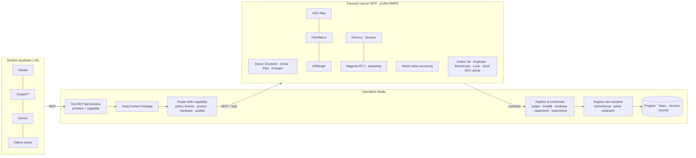

# OpenBand — Specifica unificata v0.6 (Parte A: "Produrre è semplice" · Parte B: "Ensemble")

> **Per Claude Code.** Salvala in `docs/SPEC-v0.6.md`. Questo file **unisce e sostituisce** le bozze v0.4 (G1–G7) e v0.5 (Ensemble); la vecchia bozza "Motori AI H0–H5" è superata e non va implementata.
> Base: `main` v0.5.0 (F1–F26, D1–D10, 129 tool in `server/tools.mjs`, chat nella pagina con Claude/OpenAI/Gemini/Ollama/OpenAI-compatibili). Valgono le regole e la Definition of Done della **sezione 0 di `docs/SPEC.md`**.

## Come le due parti si incastrano (leggere prima di tutto)

- La **Parte B (Ensemble)** è l'architettura: OpenBand diventa anche client MCP verso "Esecutori" (motori generativi locali o online) secondo l'**Open Music Engine Profile (OMEP)**, con Song Context Package, router, pipeline di conformità e registro dei contributi.
- La **Parte A** contiene le feature di prodotto. Alcune vanno costruite **direttamente come esecutori builtin OMEP**, per non doverle rifare:
  - **G1 Mix & Master Pilot** → capability `mix.assist` (più catena master, limiter, export per piattaforma, che restano funzioni dello Studio)
  - **G2 Disegna la canzone** → capability `music.arrange` (builtin), usata da `arrange`
  - **G3 Ghost notes** → capability `symbolic.continue` / `harmonize` / `accompany` / `drums` (builtin)
  - **G5 Sound-alike** → capability `audio.match_sound` (builtin)
  - **G4 Studio a mani libere** e **G8 Plugin nativi** restano funzioni dello Studio (non sono esecutori); i parametri dei plugin nativi sono però utilizzabili da `mix.assist` (G1) e `audio.match_sound` (G5)
  - **G6 Pubblica** e **G7 Tutela** leggono il **Contribution Ledger** (Parte B §6) per `aiDisclosure`, crediti, attribuzioni e manifest della prova
- I tool MCP nuovi della Parte A vanno registrati nel **sistema a livelli** della Parte B §8: toolset di dominio `mix`, `arrange`, `suggest`, `voice`, `sound`, `plugins`, `release`, `protect`, caricabili con `load_toolset`, mentre `create`/`transform` li raggiungono tramite il router.
- **Non regressione** (Parte B §8.4): le interfacce esistenti per Claude, ChatGPT/OpenAI, Gemini, Ollama/OpenAI-compatibili e i client MCP restano identiche; `--toolsets=all` mantiene il comportamento di oggi.

## Ordine di implementazione unificato (una voce = una PR, salvo dove indicato)

| # | Lavoro | Parte | Note |
|---|---|---|---|
| 1 | **E0** — OMEP 1.0, SCP 1.0, Contribution (JSON Schema), motore mock, `omep-conformance` | B §2–3, §11 | Solo infrastruttura e test |
| 2 | **E1** — Host dei motori, router (filtri, best, pinned, fallback), conformità passi 1–4 e 9, ledger di base, server OMEP builtin con Drummer/loop esistenti | B §4–6, §9 | `create` funziona col Drummer interno e col mock |
| 3 | **G1** — Mix & Master Pilot come builtin `mix.assist` + catena master, limiter, sidechain, HPF, export per piattaforma | A G1 | Prerequisiti engine in PR separata se grandi |
| 4 | **G8** — Plugin nativi VST3 / CLAP / AU nell'app desktop (PR G8.1–G8.9, in ordine) | A G8 | Indipendente da Ensemble; parte da `docs/adr/0001-desktop.md` |
| 4b | **G3** — Ghost notes come builtin `symbolic.*` | A G3 | Locale, < 50 ms |
| 5 | **G2** — Disegna la canzone come builtin `music.arrange` | A G2 | Usa G1 `roles.ts` |
| 6 | **E2** — Direttore razionalizzato: tool a livelli, `load_toolset`, `create`/`transform`, `openband://context`, prompt MCP, task MCP | B §8 | Test di non regressione §8.4 obbligatori |
| 7 | **E3** — Primi esecutori veri, online e locali: `omep-fal` + relay deployabile + preventivi/budget; Demucs nel browser; ACE-Step locale; DiffSinger (+ g2p italiano); conformità passi 5–8 | B §9-bis, §10 | Milestone chiave: utente senza GPU dalla demo online |
| 8 | **G4** — Studio a mani libere (voce, pedale, sessione) | A G4 | |
| 9 | **G5** — Sound-alike come builtin `audio.match_sound` | A G5 | Prima PR: synth parametrici |
| 10 | **E4** — Ensemble e gusto: A/B cieco tra motori, preferenze, scheduler GPU | B §7, §11 | |
| 11 | **G6** — Pubblica (SoundCloud, YouTube, Mixcloud, Audius, Internet Archive, Wikimedia Commons, Funkwhale; Creative Commons) | A G6 | `aiDisclosure` dal ledger |
| 12 | **G7** — Tutela (OpenTimestamps; ~~Safe Creative~~ tolto il 25/10/2026) | A G7 | Manifest con il ledger |
| 13 | **E5** — Tempo reale (stream OMEP, Magenta RT 2) | B §2.5, §11 | Locale/LAN |
| 14 | **E6** — Ecosistema: ~~registro motori~~ (tolto il 25/10/2026), template, HeartMuLa, ComfyUI, valutazione C2PA | B §10–11 | |

Dove le due parti si contraddicono, **vale la Parte B** per architettura e tool MCP, e **vale la Parte A** per il comportamento di prodotto e i criteri di accettazione delle feature G.

---


# PARTE A


> Per Claude Code. Parte A della v0.6. Si basa sullo stato di `main` al 21/10/2026 (v0.5.0: F1–F26, D1–D10, 129 tool MCP, qualsiasi AI). Valgono le regole della sezione 0 di `docs/SPEC.md` (comandi condivisi UI/MCP in `commands.ts`, definizioni tool in `server/tools.mjs`, logica pura testabile, DSP nei worker, i18n IT/EN, una feature per PR, Definition of Done).
>
> **Filo conduttore**: ognuna di queste 5 feature sostituisce **decine di decisioni tecniche con un solo gesto musicale**: disegnare una curva, premere Tab, girare una manopola, trascinare un suono, parlare. Tutte funzionano **anche senza AI collegata** (algoritmi locali e deterministici), e diventano più potenti quando l'AI c'è. Tutte producono il risultato come **una transazione F1** e, quando cambiano molto, come **un branch F13**, così l'utente confronta con la compare view e non perde nulla.

| # | Feature | Il gesto | Cosa sostituisce | Peso |
|---|---|---|---|---|
| G1 | **Mix & Master Pilot** | Una manopola "Quanto" + un target | Gain staging, bilanciamento, EQ a incastro, pan, sidechain, mastering, export per piattaforma | L |
| G2 | **Disegna la canzone** (curva di energia → arrangiamento) | Disegnare una linea sopra la timeline | Trasformare un loop di 8 battute in una canzone intera con transizioni | L |
| G3 | **Ghost notes: autocompletamento musicale** | Premere Tab | Scrivere la battuta successiva, il basso, la contromelodia, gli accordi | M |
| G4 | **Studio a mani libere** (voce + pedale + sessione automatica) | Parlare con lo strumento in mano | Mouse, tastiera, punch, gestione take | M |
| G5 | **Sound-alike** (dal suono alla patch) | Trascinare un suono | Ore di sound design e di ricerca di preset | L |
| G6 | **Pubblica** su SoundCloud, YouTube, Mixcloud, Audius, Internet Archive, Wikimedia Commons, Funkwhale (anche in Creative Commons) | "Pubblica" | Metadati, copertina, LRC, video, upload manuale su ogni sito | M |
| G7 | **Tutela**: prova di paternità su blockchain + registrazione su Safe Creative | "Proteggi" | Depositi manuali, costi, attese | S |
| G8 | **Plugin nativi** VST3 / CLAP / AU nell'app desktop | Aprire un plugin che hai già | Passare a un'altra DAW per usare i propri plugin | L |

Ordine consigliato: **G1 → G2 → G3 → G4 → G5**. G1 colma l'unico vuoto rimasto rispetto a una DAW completa (non c'è ancora un mastering) ed è quello che l'utente nota per primo.

---

## G1 · Mix & Master Pilot

**Obiettivo**: da "ho registrato e programmato" a "suona come un disco ed è pronto per Spotify" con **un pulsante e una manopola**. Ogni scelta è spiegata, reversibile e confrontabile a volume pareggiato. Oggi `analyze_mix`, il reference matching e il linter *diagnosticano* e *suggeriscono*; il Pilot *esegue*, con un dosaggio.

### Prerequisiti da aggiungere all'engine
1. **Catena master** (`Project.master?: MasterChain`), inclusa nel render offline:
   ```ts
   interface MasterChain {
     on: boolean;
     eq: { on: boolean; tilt: number /* dB/oct −3..+3 */; low: number; high: number; bands?: { hz: number; gain: number; q: number }[] };
     glue: { on: boolean; threshold: number; ratio: number; attack: number; release: number; makeup: number };
     width: { on: boolean; amount: number /* 0..2, 1 = invariato, M/S */; monoBelowHz: number };
     limiter: { on: boolean; ceilingDbtp: number /* es. −1 */; targetLufs: number; release: number };
   }
   ```
   - **Limiter true-peak con lookahead**: un AudioWorklet (`src/audio/worklets/limiter.worklet.ts`) con 5 ms di lookahead, release adattivo, detection con oversampling 4× (riusa il codice true-peak del meter F20). La stessa implementazione pura serve il render offline.
   - **Loudness target**: il guadagno di ingresso del limiter si calcola **iterando sul render offline**: render → LUFS integrata → correzione → max 3 iterazioni, tolleranza ±0,3 LU.
2. **Sidechain** sul compressore di traccia: `comp.sidechain?: { sourceTrackId: string; amount: number }`, con il key dal segnale pre-fader della traccia sorgente. Serve per kick→basso.
3. **Filtro passa-alto** di traccia: `eq.hpf?: { on: boolean; hz: number }` (12 dB/oct).

### Algoritmo del Pilot (`src/pilot/`, puro tranne il render)
Input: progetto, `amount 0..1`, `target` (genere + piattaforma), opzionale reference (F6).
1. **Ruoli delle tracce** (`roles.ts`): classificazione automatica in `kick | drums | bass | harmony | lead | vocal | texture | fx`, usando kind, preset, registro medio, densità di note, nome traccia (IT/EN: "voce", "vox", "basso"…) e banda dominante da `analyze_mix`. L'utente può correggere il ruolo dal mixer, e la correzione vale anche per la volta dopo.
2. **Gain staging**: porta ogni traccia a un livello di lavoro pre-fader omogeneo (≈ −18 LUFS short-term max) con un trim, non con il fader.
3. **Bilanciamento statico**: tabelle per genere (`profiles/*.json`: pop, rock, hip-hop, lo-fi, edm, acoustic/cantautore, ambient, jazz) con la loudness relativa per ruolo (es. pop: vocal 0 dB, kick −2, bass −3, harmony −8…). Con una reference caricata, le quote per banda vengono dalla reference (F6) invece che dalla tabella.
4. **Spazio in frequenza**: per ogni coppia mascherata (`masking.ts`) taglia la traccia **meno prioritaria per ruolo** nella banda condivisa (−1…−4 dB, Q 1,2). Aggiunge un HPF su tutto ciò che non è kick/bass (frequenza in base al registro più basso suonato, −1 ottava).
5. **Sidechain** kick→bass se il masking basso/kick è > 0,5 e il genere lo prevede (edm, hip-hop, pop).
6. **Pan**: distribuzione per ruolo e registro. Kick, bass, lead e vocal al centro; harmony e texture allargati a coppie e speculari, con ampiezza dipendente dal genere.
7. **Spazio**: send di riverbero/echo per ruolo e genere (vocal e lead più "bagnati" in pop/ambient, tutto più asciutto in hip-hop).
8. **Master**: tilt EQ verso la curva del genere o della reference, glue leggero (1,5–2 dB di gain reduction), width con mono sotto 120 Hz, limiter al target della piattaforma (Spotify −14, Apple −16, YouTube −14, SoundCloud −11, Club −8, CD −9; ceiling −1 dBTP, −0,5 per il CD).
9. **Dosaggio**: ogni modifica è un delta rispetto allo stato attuale; `amount` scala tutti i delta (in dB, in pan, nei send), da 0 = niente a 1 = proposta piena. Il master limiter applica sempre il target, perché è una specifica e non un gusto.
10. **Verifica**: render → `analyze_mix` → se restano issue `error` (clipping, fase) corregge e riprova, massimo 2 passaggi.

### Spiegazione e confronto
- Tutto in **una transazione** "Mix Pilot (pop, Spotify, 70%)", con un'annotazione F14 per ogni decisione non banale ("Ho tagliato 3 dB a 250 Hz sul Pad: copriva la voce").
- **Before/After a volume pareggiato** (riusa il level match di F20) con il pulsante "Ascolta prima".
- La manopola "Quanto" rimane **viva** dopo l'applicazione: girarla ricalcola i delta in tempo reale, come un preset parametrico (stato salvato in `Project.pilot`), finché l'utente non fa "Fissa".

### Export per piattaforma
`Esporta per…` produce in un clic uno zip con:
- master WAV 24 bit (16 bit dithered TPDF per il CD) a loudness e true-peak conformi, più un report;
- **instrumental** (ruolo vocal muto), **a cappella**, **stems per ruolo** (drums, bass, harmony, lead, vocal, fx), passando dallo stesso master chain con il limiter in modalità "linked" (stessi guadagni del master completo, così le stem sommate tornano al master);
- un file `report.txt` con LUFS, true peak, LRA e conformità per ogni piattaforma scelta.

### Tool MCP
| Tool | Args |
|---|---|
| `mix_pilot` | `amount 0..1, genre?, platform?, use_reference?, scope?: 'mix'\|'master'\|'both'` → elenco delle modifiche con spiegazione |
| `set_pilot_amount` | `amount` |
| `set_master_chain` | `eq?, glue?, width?, limiter?` |
| `set_track_role` | `track_id, role` |
| `export_for_platforms` | `platforms[], stems?: boolean, versions?: ('instrumental'\|'acapella')[], save_to?` |

**Accettazione**
- Test del limiter: nessun sample oltre il ceiling misurato in true-peak 4×; target LUFS raggiunto entro ±0,3 LU su 3 fixture di generi diversi.
- `amount = 0` → progetto invariato (diff vuoto); `amount = 1` due volte di seguito → idempotente.
- La somma delle stem è uguale al master entro −60 dB di residuo.
- Le correzioni di ruolo dell'utente sopravvivono a una nuova esecuzione del Pilot.

---

## G2 · Disegna la canzone (curva di energia → arrangiamento)

**Obiettivo**: il problema più comune dei principianti è il "loop di 8 battute che non diventa mai una canzone". Qui l'utente **disegna l'energia nel tempo** con il mouse (o sceglie una forma: "pop classico", "slow build", "drop EDM", "ballad"), e OpenBand costruisce l'arrangiamento completo a partire dal materiale che c'è.

### Modello
```ts
interface EnergyCurve { points: { bar: number; energy: number /* 0..1 */ }[]; length_bars: number; shape?: string }
// Project.energy?: EnergyCurve
```

### UI
- Una corsia **"Energia"** sopra la corsia Struttura: si disegna a mano libera o si trascinano i punti, con preset di forma e lunghezza target ("3:30 a 92 BPM" → numero di battute).
- La curva della canzone **attuale** (misurata) viene mostrata in grigio sotto quella disegnata, così si vede dove manca energia.
- Pulsante **"Arrangia"** → il risultato va in un branch `arrangement-<n>`, aperto subito in compare view.

### Algoritmo (`src/arranger/`, puro e deterministico con seed)
1. **Materiale**: individua le idee esistenti (regioni e sezioni, `auto_sections`), i ruoli delle tracce (G1 `roles.ts`) e il giro armonico (`analyze_harmony`).
2. **Segmentazione**: divide la curva in sezioni in multipli di 4/8 battute, dove la pendenza cambia o si superano soglie. Etichetta le sezioni per energia e posizione (intro bassa all'inizio, ritornello sui picchi, bridge sulla valle dopo il secondo picco, outro in coda). Le sezioni esistenti vengono riusate quando combaciano.
3. **Mappatura energia → leve** (tabella per genere), da combinare:
   - numero di **layer attivi** per ruolo (da solo pad e voce fino a tutto);
   - **drummer** (F24): `complexity` e `loudness` della sezione, fill prima delle sezioni con energia crescente;
   - **registro**: raddoppio d'ottava di lead/harmony nelle sezioni alte;
   - **ritmo dell'armonia**: block → stabs → arpeggio al crescere dell'energia (`add_chord_progression` style);
   - **filtro**: automazione di tone (F22) che apre in crescendo;
   - **send** di riverbero più alti nelle valli.
4. **Variazione per non ripetere**: la seconda strofa riceve un layer o un groove in più rispetto alla prima, e il ritornello finale si alza (modulazione opzionale +1/+2 semitoni, solo se l'utente la attiva).
5. **Transizioni** generate e sintetizzate localmente: riser (rumore filtrato con sweep), downlifter, reverse cymbal (crash del kit invertito), drum fill, **stop** di una battuta prima del drop, impact. Ognuna è una regione su una traccia "FX transizioni" creata dall'arranger.
6. **Finale**: outro in fade (automazione volume) o finale su accordo di tonica con crash, a seconda della curva.
7. Rispetto per i contenuti dell'utente: le regioni scritte a mano non vengono **mai** modificate nelle note; vengono solo duplicate, spostate, mutate o filtrate. Solo i contenuti generati (drummer, accordi, transizioni) vengono rigenerati.

### Tool MCP
| Tool | Args |
|---|---|
| `set_energy_curve` | `points` o `shape`, `length_bars?` |
| `get_energy` | readOnly: curva disegnata + curva misurata per battuta |
| `arrange_from_energy` | `seed?, genre?, as_branch?: boolean=true, keep_sections?: boolean` → sezioni create, layer per sezione, transizioni |
| `add_transition` | `at_bar, kind: 'riser'\|'downlifter'\|'reverse_cymbal'\|'fill'\|'stop'\|'impact', bars?` |

**Accettazione**: da un loop di 8 battute (fixture con batteria, basso, accordi e lead) si ottiene una canzone della lunghezza richiesta, con almeno intro, strofa, ritornello e outro, e la curva misurata segue quella disegnata (correlazione > 0,7). Stesso seed → stesso risultato. Le note delle regioni utente restano identiche (test sul diff).

---

## G3 · Ghost notes: autocompletamento musicale ("Tab per accettare")

**Obiettivo**: il "Copilot" del piano roll. Mentre scrivi, OpenBand propone in grigio la continuazione; **Tab** accetta, **⇧Tab** mostra l'alternativa successiva, **Esc** la ignora. È **locale, istantaneo (< 50 ms) e senza LLM**: niente latenza, niente chiave, funziona offline.

### Cosa suggerisce (in base al contesto)
| Contesto | Suggerimento |
|---|---|
| Melodia scritta fino a metà battuta | Completa la battuta e propone la successiva |
| Regione di basso vuota su una traccia bass, con accordi presenti | Linea di basso che segue gli accordi (root/quinta/passaggi, nello stile del genere) |
| Melodia selezionata | **Armonizza**: 3 progressioni di accordi possibili, mostrate come regione fantasma su una traccia harmony |
| Melodia + accordi | **Contromelodia** in registro libero, con moto contrario |
| Step sequencer a metà battuta | Completa il pattern, oppure propone un fill a fine sezione |
| Ritornello già scritto, nuova sezione vuota | Variazione del motivo (stesso ritmo con altezze trasposte nel grado, oppure inversione) |

### Motore (`src/suggest/`, nel worker)
- **Vincoli armonici**: tonalità e accordo sotto la posizione (`analyze_harmony`), con le note dell'accordo nei tempi forti e le note di passaggio in scala nei deboli.
- **Modelli statistici leggeri**:
  - **Markov a ordine variabile (PPM)** su coppie (intervallo, durata) per la melodia, e sui gradi per gli accordi;
  - **addestrati prima sul brano corrente** (peso alto, così le idee restano coerenti), poi su **tutti i progetti dell'utente** (indice in IndexedDB, aggiornato in background, sempre locale), poi su un piccolo **corpus CC0** incluso (melodie e progressioni scritte apposta e generate con OpenBand, ~200 frasi, licenza tracciata).
- **Motivi**: rileva ripetizioni (n-gram ritmici) e privilegia la ripetizione con variazione, perché è così che le canzoni restano in testa.
- **Ranking**: punteggio = probabilità del modello + coerenza armonica + range cantabile (per vocal/lead: estensione ≤ un'ottava e mezza, salti > 7 semitoni penalizzati) + varietà rispetto alla battuta precedente. Restituisce le prime 3.
- **Apprendimento dalle scelte**: accettare o rifiutare aggiorna i pesi locali dell'utente (con un pulsante "Azzera quello che ho insegnato").

### UI
- Note fantasma grigie con un piccolo indicatore "1/3"; si attivano dopo 600 ms di inattività nel piano roll.
- Toggle "Suggerimenti" nell'editor (attivo di default per i nuovi utenti). Con `?` si apre la spiegazione di perché ha suggerito quello: "note dell'accordo Am sui tempi forti, ripete il ritmo di battuta 2".
- In jam mode (F15) lo stesso motore dà una **risposta istantanea locale** mentre l'LLM elabora la sua. Se l'LLM arriva in tempo per la finestra successiva, quella locale viene sostituita.

### Tool MCP
`suggest_continuation({region_id, kind?: 'continue'|'bass'|'harmonize'|'counter'|'variation'|'drum_fill', count?, seed?})` → candidati come liste di note. L'AI li può usare come bozza veloce da rifinire.

**Accettazione**
- Latenza p95 < 50 ms per 3 suggerimenti su una regione di 64 note (benchmark in CI).
- Su fixture armoniche, le note sui tempi forti appartengono all'accordo in ≥ 90 % dei casi.
- Nessun dato lascia il browser (test che verifica l'assenza di fetch durante il suggerimento).
- Tab/⇧Tab/Esc funzionano e Tab crea una sola voce di undo.

---

## G4 · Studio a mani libere (voce + pedale + sessione automatica)

**Obiettivo**: chi registra ha in mano una chitarra o sta davanti al microfono e non può toccare il mouse. Si comanda tutto **a voce** (o con il pedale), e la **modalità Sessione** gestisce take, errori e scelta della migliore da sola.

### Comandi vocali
- **Riconoscimento**:
  - prima scelta: **Vosk in WASM** (Apache-2.0), con modelli piccoli IT ed EN (~40–50 MB, scaricati on-demand e messi in cache dal service worker), **offline e privato**;
  - fallback: Web Speech API dove disponibile, con avviso che su alcuni browser l'audio passa da un servizio esterno.
  - Una **grammatica ristretta** (comandi fissi più numeri e nomi di sezioni) rende il riconoscimento robusto anche con un modello piccolo.
- **Attivazione**: push-to-talk da pedale MIDI (CC configurabile con Learn, come per i flub F18), tasto tenuto premuto, oppure parola chiave "OpenBand…" (opzionale, disattivata di default).
- **Comandi v1 (IT/EN)**:
  | Frase | Azione |
  |---|---|
  | "registra" / "record" | Record con count-in |
  | "stop", "ancora" / "again", "riascolta" / "play back" | Trasporto |
  | "dal ritornello", "dalla battuta nove" | Posizionamento per sezione o battuta |
  | "loop sul ritornello" | Cycle sulla sezione |
  | "punch dalla nove alla dodici" | `set_punch` |
  | "segna errore" / "buona questa" | Flub F18 |
  | "tieni questa", "cancella l'ultima take" | Gestione take |
  | "metronomo più forte/piano/via", "più lento", "tempo novanta" | Click e BPM |
  | "più me in cuffia", "meno basi" | Livello di monitoraggio input/playback (solo ascolto) |
  | "annulla" | Undo |
- **Fallback verso l'AI**: una frase fuori grammatica, se c'è un'AI collegata, diventa un evento `ask` con trascrizione (dettatura libera con Vosk in modalità large-vocabulary). Senza AI arriva un messaggio "Non ho capito, i comandi sono…".
- **Comandi detti durante la registrazione**: il tratto di audio in cui è stato pronunciato il comando viene **marcato e silenziato nella take** (con fade di 10 ms), così "segna errore" non finisce nel mix.
- **Feedback parlato** (speechSynthesis, disattivabile): "Take 3 registrata. Due errori segnati."

### Modalità Sessione
"Sessione su: Strofa 1, 5 passaggi" (da UI o a voce):
1. va in loop sulla sezione con pre-roll, e ogni passaggio diventa una take;
2. i flub (voce, pedale, tasto) si agganciano alla take corrente;
3. **valutazione automatica** di ogni take, oltre ai flub:
   - per le take audio: intonazione media rispetto alla melodia guida, se esiste (pitch track F11, deviazione in cent), timing degli attacchi rispetto alla griglia, clipping;
   - per le take MIDI: timing, note fuori scala.
   Il punteggio è mostrato accanto a ogni take;
4. alla fine fa **comping automatico** "migliore per battuta" (punteggio + flub + marcatori good, riusando `replace_with_best_take` di F18) e propone l'ascolto del comp con A/B rispetto alla take singola migliore.
5. "Basta così" interrompe la sessione in qualsiasi momento.

### Tool MCP
`start_session({section_id | from_bar,to_bar, passes, track_id?})`, `stop_session`, `get_session` (take con punteggi), `set_voice_control({enabled, engine, push_to_talk_cc?})`. Eventi nuovi: `voice_command`, `session_take`, `session_done`.

**Accettazione**
- Test della grammatica: ≥ 95 % di riconoscimento su un set di registrazioni di test IT/EN (fixture audio generate con TTS più 10 registrazioni reali).
- Il comando detto in registrazione è silenziato nella take (test sul buffer).
- Sessione di 5 passaggi con flub simulati → il comp sceglie le battute senza flub.
- Funziona offline con Vosk già in cache.

---

## G5 · Sound-alike: dal suono alla patch

**Obiettivo**: "voglio quel suono". L'utente trascina un sample (una nota di synth, un basso, un pluck), seleziona un pezzo della reference oppure **descrive** il suono ("caldo, morbido, attacco lento"). OpenBand trova i **parametri** degli strumenti interni o dei plugin WAM che ci si avvicinano di più e crea uno **strumento suonabile**, non un sample.

### Prerequisito: strumenti parametrici
Esponi lo schema dei parametri dei preset sintetizzati (`audio/instruments.ts`): oscillatori, mix, filtro (cutoff, Q, env amount), ADSR di ampiezza e filtro, detune, unison, FM index dove presente. `Track.synthParams?: Record<string, number>` sovrascrive il preset e viene salvato nel progetto. Ogni parametro ha range, scala (lin/log) e default. Senza questo la feature non si fa, quindi va nella prima PR.

### Motore (`src/soundmatch/`, nel worker)
1. **Analisi del target**:
   - stima del pitch (YIN F11) e della durata della nota;
   - feature su finestre di 10 ms: log-mel spectrogram (64 bande), MFCC (13) e loro delta, centroide e flatness spettrali, inviluppo RMS;
   - per sample polifonici o in un mix, isola una nota (onset → finestra) e avvisa se è troppo sporca.
2. **Distanza**: combinazione pesata di (a) distanza sul log-mel allineato nel tempo (DTW leggero sugli inviluppi), (b) MFCC medi, (c) forma dell'inviluppo (attacco, decay, sustain stimati).
3. **Ricerca**:
   - **multi-start** dai preset compatibili per famiglia (bass, pluck, pad, lead, keys), poi **CMA-ES** (implementazione propria, piccola) sui parametri normalizzati;
   - ogni valutazione = render offline di una nota allo stesso pitch e durata (OfflineAudioContext breve, ~0,5–2 s). Valutazioni in parallelo su più worker (`navigator.hardwareConcurrency − 1`). Budget di default ~300 valutazioni (pochi secondi su un laptop) con un progresso visibile;
   - stessa logica per i **plugin WAM** che espongono parametri (`getParameterInfo`), con budget più alto e avviso sui tempi.
4. **Risultato**: le 3 migliori patch, con percentuale di somiglianza e un'anteprima A/B "originale vs patch" a volume pareggiato. "Usa" crea una traccia (o sostituisce lo strumento della traccia selezionata) con quei `synthParams`, salvabile come preset utente nella Library.
5. **Da parole a suono**: dizionario di descrittori IT/EN → vincoli sui parametri (es. "caldo" = cutoff basso e saturazione leggera; "plucky" = attacco 0, decay breve, sustain 0; "largo" = unison/detune; "scuro", "brillante", "metallico" (FM), "morbido", "aggressivo"…), combinabili ("basso caldo e plucky"). Il risultato è un punto di partenza nello spazio dei parametri, senza ottimizzazione. Combinato con un sample, i descrittori diventano vincoli della ricerca.
6. **Tone match per le tracce audio** (stessa infrastruttura, problema più semplice): EQ a 6 bande + drive dell'amp sim ottimizzati per avvicinare lo spettro medio di una traccia (es. la chitarra) a quello di un riferimento. Utile per "fai suonare la mia chitarra come quella del disco".

### Tool MCP
| Tool | Args |
|---|---|
| `match_sound` | `source` (fileTool) o `sample_id` o `{reference_from_seconds, to_seconds}`, `target?: 'synth'\|'plugin'\|'auto'`, `family?`, `budget?` → 3 candidati con somiglianza |
| `sound_from_words` | `description, family?` |
| `apply_patch` | `candidate_id, track_id?` |
| `tone_match` | `track_id, source \| reference range` → EQ/amp proposti |
| `set_synth_params` | `track_id, values` |

**Accettazione**
- **Test di ritrovamento**: si renderizza un preset con parametri casuali noti, poi si chiede a `match_sound` di trovarlo; la somiglianza del primo candidato è ≥ 0,9 e i parametri principali (cutoff, ADSR) sono entro il 15 % su ≥ 80 % di 20 casi.
- `sound_from_words("basso caldo plucky")` → patch nella famiglia bass con attacco < 10 ms e cutoff sotto la mediana del preset.
- Budget di default completato in < 10 s su CI (4 core) per i synth interni.
- Nessun upload: tutto nel browser.

---

## G6 · Pubblica: solo piattaforme con API aperte

**Perimetro**: solo le piattaforme che permettono l'**upload via API pubblica**, con OAuth o chiavi dell'utente e registrazione dell'app aperta agli sviluppatori. Niente distributori (DistroKid, TuneCore…: nessuna API pubblica) e niente automazione di form altrui. Spotify, Apple Music e gli altri store restano fuori finché non apriranno un'API.

### Piattaforme incluse (verificate a ottobre 2026)
| Piattaforma | API | Auth | Vincoli da gestire |
|---|---|---|---|
| **SoundCloud** | `POST /tracks` multipart (fino a 4 GB, WAV/FLAC/AIFF/MP3…) | OAuth 2.1 + PKCE; client secret obbligatorio (tutti i client sono "confidential") | Token di ~1 h, refresh token monouso. Il secret non può stare nell'app web statica |
| **YouTube** | Data API `videos.insert` (resumable upload) | OAuth 2.0 Google | Quota: 1 unità nel bucket "Video Uploads", 100 chiamate al giorno per progetto. Serve un **video**: OpenBand lo genera (vedi sotto) |
| **Mixcloud** | `POST https://api.mixcloud.com/upload/` multipart (audio fino a 4 GB, cover fino a 10 MB, tracklist con tempi, max 5 tag) | OAuth 2.0, secret lato server | Pensato per mix e show lunghi; programmazione dell'uscita solo per account Pro |
| **Audius** | SDK ufficiale `@audius/sdk` (upload di tracce) | API key + OAuth 2.0 PKCE per agire per conto dell'utente; bearer token solo lato backend | Piattaforma aperta, pensata per gli sviluppatori |
| **Internet Archive** | API S3-like `PUT https://s3.us.archive.org/<item>/<file>` con metadati negli header `x-archive-meta-*` | Chiavi S3 personali dell'utente (`LOW access:secret`) | Ottimo per brani con licenza Creative Commons; il caricamento è permanente e pubblico: va avvisato in modo chiaro |
| **Funkwhale** (federato, ActivityPub) | API dell'istanza (Funkwhale 2.0 ha introdotto la API v2) | OAuth dell'istanza scelta dall'utente | Istanze diverse = regole diverse (alcune chiedono metadati MusicBrainz); le istanze v2 non federano con le v1 |

| **Wikimedia Commons** | MediaWiki API `action=upload` (con chunked upload per i file grandi) | OAuth 2.0 Wikimedia | **Solo licenze libere**: CC0, CC BY, CC BY-SA. NC e ND non sono ammesse, quindi il pulsante si disattiva se la licenza scelta non è compatibile. Formati: Ogg (preferito) e FLAC. La pagina file va compilata con i template `{{Information}}` e quello di licenza, generati dal Release Kit |

**Escluse dopo la verifica**: TikTok (escluso per scelta di prodotto), Audiomack (l'API documentata non ha endpoint di upload), Bandcamp (nessuna API di upload), hearthis.at (documentazione dell'upload non verificabile), Jamendo (l'API v3 ha solo download e azioni da fan, nessun upload), Free Music Archive (upload solo dal wizard web, MP3), ccMixter (nessuna API di upload), distributori verso gli store.

### Licenza Creative Commons: si **applica**, non si deposita
Creative Commons non è un registro: non esiste un "deposito CC". La licenza si **dichiara** sull'opera, e chi la vuole tracciabile la pubblica dove resta consultabile e datata. OpenBand lo rende un gesto solo:
- **Scelta guidata della licenza** (3 domande: uso commerciale? modifiche? stessa licenza per le derivate?) → CC0, CC BY, CC BY-SA, CC BY-NC, CC BY-ND, CC BY-NC-SA, CC BY-NC-ND, con la spiegazione in parole semplici. Avviso: "Le licenze CC sono irrevocabili per le copie già distribuite."
- **Compatibilità con la raccolta proventi**: gli iscritti a una società di gestione possono avere vincoli sull'uso delle licenze CC, specie per l'uso commerciale. Avviso a verificare con la propria società prima di pubblicare.
- **Metadati incorporati**: tag nel file (FLAC/Ogg `LICENSE`, `COPYRIGHT`, `CONTACT`; ID3 `TCOP` + `WCOP` con l'URL della licenza in MP3), XMP nella copertina, e un `LICENSE.txt` con il link al deed.
- **Licenza coerente con il contenuto**: il linter (F7, categoria `release`) blocca una licenza CC se il progetto contiene sample o loop con licenza incompatibile. Il registro delle licenze dei loop CC0 (F24) e dei sample importati lo rende verificabile.
- **Dove pubblicarla con API aperte**: **Internet Archive** (collezioni audio/netlabel, metadato `licenseurl`), **Wikimedia Commons** (solo CC0/BY/BY-SA), **Funkwhale**, più SoundCloud (tutte le licenze CC nel campo `license`) e YouTube (solo CC BY). Per Audius il campo licenza va verificato sull'SDK al momento dell'implementazione. Il pulsante "Pubblica in CC" seleziona da solo le piattaforme compatibili con la licenza scelta.
- **Prova della data**: insieme alla pubblicazione si può fare la marca temporale G7 del manifest, con la licenza dentro, così resta provato *quando* l'opera è stata rilasciata e *con quale* licenza.

### Architettura
- **Adapter per piattaforma** (`src/publish/adapters/<name>.ts`) con un'interfaccia comune: `authorize()`, `validate(release)` → issue, `upload(release, assets, onProgress)` → `{url, id}`, `status(id)`.
- **I segreti non stanno mai nell'app web**. SoundCloud, Mixcloud e YouTube con secret passano dal processo locale (`npx openband`, app desktop F26) o dall'istanza self-hosted (D9/D10), che fa da OAuth broker. **Ogni utente registra la propria app** sulla piattaforma (wizard passo passo con screenshot) e incolla `client_id`/`secret` nelle impostazioni locali, cifrate con la keychain del sistema nell'app desktop. Audius (PKCE) e Internet Archive (chiavi personali) funzionano anche dal solo browser.
- Upload **resumable/chunked** dove supportato (YouTube, SoundCloud fino a 4 GB) con progress e ripresa dopo un errore.
- Lo stato di ogni pubblicazione è salvato nel progetto (`Project.publications[]`: piattaforma, id, url, data, versione del master pubblicata), così sai sempre cosa è uscito e dove.

### Release Kit (necessario per tutte)
- **Metadati comuni** (`Release`): titolo, artista, featuring, genere, tag, descrizione, lingua, explicit, data, crediti, licenza (tutti i diritti riservati / CC BY / CC BY-SA… → obbligatoria per Internet Archive), **dichiarazione d'uso dell'AI** precompilata dal journal F21.
- **Audio**: riusa G1 `export_for_platforms`: WAV/FLAC per SoundCloud, Audius e Internet Archive; MP3 320 per Mixcloud; AAC dentro l'MP4 per YouTube. Loudness e true-peak conformi.
- **Copertina**: controllo dimensioni e formato per piattaforma, più un generatore di copertine tipografiche (deterministico, con seed).
- **Testi**: plain e **LRC** sincronizzato (dall'allineamento F10), messi nella descrizione o nei campi dedicati dove esistono.
- **Video generato** per YouTube (WebCodecs → MP4 H.264/AAC, nel worker): copertina + waveform/spettro animati + testi sincronizzati. Formato 16:9, più un 9:16 opzionale per gli Shorts con un estratto di 15–60 s scelto automaticamente dal ritornello (sezioni F8).
- **Validazione** per piattaforma come issue del linter (categoria `release`), con fix.

### Tool MCP
| Tool | Args |
|---|---|
| `get_release` / `set_release` | metadati |
| `check_release` | `platforms[]` → issue per piattaforma |
| `generate_cover` | `style?, palette?, seed?` |
| `render_video` | `format: '16:9'\|'9:16', section_id?, max_seconds?` |
| `list_publish_targets` | readOnly: piattaforme configurate e stato dell'autorizzazione |
| `publish` | `platforms[], privacy?: 'private'\|'unlisted'\|'public'` → **richiede sempre conferma nell'interfaccia**; l'AI non pubblica mai da sola |
| `get_publications` | readOnly |

**Accettazione**
- Test di ogni adapter contro un **mock server** che riproduce gli endpoint (multipart, resumable, OAuth PKCE, errori di token scaduto e ripresa).
- Nessun secret nel bundle web (test sul build).
- `publish` senza conferma UI → errore.
- Il video si apre nei player standard, con audio e testi sincronizzati (±50 ms).
- Internet Archive: senza licenza CC selezionata il publish è bloccato con una spiegazione.
- Wikimedia Commons: con una licenza NC o ND il target è disattivato; la pagina file generata contiene i template di informazione e licenza corretti.
- Un progetto con un sample a licenza incompatibile blocca "Pubblica in CC" con un issue che indica il sample.

---

## G7 · Tutela: prova di esistenza e registrazione dell'opera

**Perimetro**: stesso criterio della G6, solo servizi con **API aperte**.

### Verifica dei servizi (ottobre 2026)
| Servizio | API aperta? | Esito |
|---|---|---|
| **OpenTimestamps** (ancoraggio su Bitcoin) | Sì: protocollo aperto e calendar server pubblici e gratuiti; si invia **solo l'hash**, mai il file | **Incluso** |
| **Safe Creative** (registro di opere privato) | Sì: API v2 pubblica con chiavi su richiesta (revisione dell'app), sandbox `arena.safecreative.org` con chiavi attive subito, autorizzazione per utente via authkey | **Incluso** (la richiesta delle chiavi di produzione la fa il progetto, una volta, dopo i test in sandbox) |
| **Soundreef / LEA** | No: deposito solo dal portale membri (`members.soundreef.com`). Il deposito Soundreef include già, gratis e opzionale, un certificato blockchain | **Escluso**: niente API pubblica |
| **SIAE** | No: deposito online solo dal portale | **Escluso** |
| **Patamu, Copyzero** | Nessuna API documentata | **Esclusi** |

### Cosa vale (da scrivere in chiaro nell'interfaccia, senza promettere troppo)
- In Italia (e nell'UE) il diritto d'autore nasce con la **creazione** dell'opera: nessun deposito è obbligatorio. Deposito e marca temporale servono come **prova della data e della paternità** in caso di contestazione.
- L'art. 8-ter del DL 135/2018 attribuisce alla memorizzazione su registri distribuiti gli effetti della **validazione temporale elettronica** ai sensi dell'art. 41 eIDAS, cioè una validazione **non qualificata**: è ammessa come prova e il giudice la valuta liberamente, ma non ha la presunzione di esattezza della validazione qualificata.
- La **raccolta dei proventi** (concerti, radio, streaming) **non** dipende da questa feature: per quella serve l'iscrizione a una società di gestione (SIAE, Soundreef/LEA…), che resta un passaggio manuale.
- Nell'UI: un box "Cosa ottieni e cosa no" e la nota "Non è una consulenza legale".

### 1. Marca temporale su blockchain (OpenTimestamps)
- **Cosa si marca**: un **manifest** dell'opera, `work.json` canonico (`canonical.ts` F13), con titolo, autori, data dichiarata, SHA-256 del master WAV, del file `.openband`, del testo e dello spartito/ChordPro, e la versione del progetto. Si marca l'hash del manifest, così con un solo timestamp si provano tutti i file.
- **Flusso**: SHA-256 nel worker → `POST` dell'hash ad almeno **2 calendar** pubblici → file `.ots` "incompleto" disponibile subito → **upgrade automatico** in background (il progetto ricorda i timestamp pendenti; si riprova all'apertura dell'app) quando la transazione Bitcoin è confermata, in genere entro qualche ora → `.ots` completo, verificabile da chiunque senza OpenBand.
- **Libreria**: `javascript-opentimestamps` è **LGPL-3**. Usarla come dipendenza npm non modificata è compatibile con la licenza MIT di OpenBand; in alternativa si implementa il client minimo (stamp + upgrade + parse/serialize `.ots`), che è un formato piccolo e documentato. Decidilo in un ADR.
- **Verifica**: pulsante "Verifica" (anche per file di terzi: trascini file + `.ots`) con controllo via block explorer pubblico, o via nodo Bitcoin locale se configurato.
- **Pacchetto "Prova"** scaricabile: `work.json`, `work.json.ots`, i file a cui si riferisce, un `LEGGIMI.txt` con le istruzioni di verifica indipendente (`ots verify`) e un **certificato PDF** leggibile (titolo, autori, hash, data del blocco Bitcoin, link agli strumenti di verifica).
- Ogni nuova **versione** pubblicata (G6) o salvata (F13) può essere marcata in automatico (opzione), così resta la catena delle versioni con le date.
- Privacy: esce solo l'hash, mai l'audio né il testo.

> **Fuori perimetro (decisione del 25/10/2026)**: la registrazione su Safe Creative non si implementa in questa versione (servirebbero chiavi del progetto per la sandbox e la produzione). Le voci qui sotto e il tool `register_safecreative` restano come riferimento.

### 2. Registrazione su Safe Creative
- Adapter `src/protect/safecreative.ts`: autorizzazione utente via authkey (l'utente approva l'app sul sito Safe Creative), upload dei file dell'opera e registrazione con i metadati del Release Kit (G6): titolo, autori/crediti, tipo di opera musicale, licenza.
- Le richieste firmate richiedono la **private key dell'app**, quindi stessa regola di G6: niente segreti nel bundle web. Passano dal processo locale, dall'app desktop o dall'istanza self-hosted.
- **Sviluppo e CI solo sulla sandbox `arena`**; la produzione si abilita con le chiavi approvate.
- Il certificato e il codice di registrazione restituiti vengono salvati nel progetto (`Project.protections[]`).

### Tool MCP
| Tool | Args |
|---|---|
| `timestamp_work` | `include?: ('master'\|'project'\|'lyrics'\|'chords')[]` → hash del manifest, stato `pending` |
| `get_protections` | readOnly: timestamp (pending/confirmed, blocco, data) e registrazioni |
| `verify_timestamp` | `file`/`sample_id` + `ots` |
| `export_proof_package` | `save_to?` |
| `register_safecreative` | **richiede conferma nell'interfaccia** |

**Accettazione**
- Test con un calendar **mock**: stamp → `.ots` incompleto → upgrade → `.ots` completo che si verifica contro un block header di fixture.
- Il manifest è deterministico: stesso contenuto → stesso hash.
- Nessun byte di audio o testo nelle richieste ai calendar (test sul payload: solo 32 byte di digest).
- Adapter Safe Creative testato contro la sandbox `arena` in un job CI opzionale (con secrets di CI) e contro un mock nei test normali.

---

## G8 · Plugin nativi VST3 / CLAP / AU (app desktop)

**Obiettivo**: nell'app desktop (Electron, F26) si caricano i plugin installati sul computer (synth, effetti, amp) accanto ai WAM, con la stessa UX: catena effetti, strumenti, automazione, undo, export, AI. È la "fase 2" già prevista da `docs/adr/0001-desktop.md`, di cui questa sezione è la specifica operativa. **Leggi l'ADR prima di iniziare**: contiene lo spike CLAP e le misure del bridge.

### Licenze (verificate)
- **CLAP**: MIT. **VST3 SDK**: MIT dalla versione 3.8 (29/10/2025; l'annuncio parla anche di "existing licensing terms", quindi va verificato il file LICENSE dell'SDK che si usa). **AU**: framework Apple di sistema. **LV2** (fase successiva, Linux): ISC.
- **ASIO** è passato a **GPLv3**. Il binario che lo includesse diventerebbe GPL, quindi **niente ASIO nel binario principale**: su Windows si usa WASAPI (anche in modalità esclusiva), e un eventuale build con ASIO sarà un componente separato, opzionale e GPL, documentato a parte.

### Architettura
1. **Processo host separato** `openband-plughost` (Rust, come da ADR), lanciato e supervisionato dal main process di Electron:
   - CLAP con `clack-host`; VST3 con binding all'SDK 3.8 (valutare i crate esistenti o un layer C++ minimo); AU su macOS (AudioToolbox; `rack` è una base già matura per AU, mentre il suo VST3 è sperimentale);
   - **isolamento dei crash**: un processo per traccia di default, oppure uno per istanza in modalità "sicura". Se un plugin va in crash, la traccia passa in **bypass**, la UI mostra "Il plugin X si è chiuso — Riavvia / Rimuovi", lo stato salvato più recente viene ripristinato al riavvio e il resto dell'app continua a suonare.
2. **Bridge audio — architettura A (ADR)**: il motore resta Web Audio; un nodo `NativePluginNode` (AudioWorklet) scambia blocchi da 128 frame con l'host.
   - **Fase 1**: il trasporto dello spike (round trip p50 5,3 ms, p99 8 ms, max ~21 ms su M1 Pro), con **jitter buffer di 6 blocchi** (~16 ms), misurato per piattaforma all'avvio.
   - **Fase 2**: **ring buffer in memoria condivisa** (mmap/memfd su macOS/Linux, `CreateFileMapping` su Windows) tra host e un addon N-API caricato in un **preload privilegiato** che espone via `contextBridge` solo `pushBlock`/`pullBlock` di Float32Array. Si rimisura e si tiene se migliora p99 e outlier.
3. **Plugin Delay Compensation (prerequisito, oggi assente nel motore)**: ogni catena dichiara la propria latenza (jitter buffer + latenza riportata dal plugin: CLAP `latency`, VST3 `getLatencySamples`). Il motore allinea tutte le tracce alla più lenta durante il playback, e il render offline la compensa esattamente. Serve anche ai WAM con lookahead.
4. **Suonare dal vivo uno strumento nativo — architettura B mirata**: quando una traccia con strumento nativo è armata o in monitoring, l'host apre direttamente il dispositivo audio (CPAL: CoreAudio, WASAPI, ALSA/PipeWire) a 64–128 frame. I note-on da tastiera MIDI arrivano all'host senza passare dal web, e il resto del mix gli arriva dal motore web come input. Così chi suona ha solo la latenza del dispositivo. Indicatore in UI: "Monitoraggio a bassa latenza attivo".
5. **Render offline ed export**: l'host processa più veloce del tempo reale (CLAP con `is_realtime: false`, VST3 `processMode = kOffline`). Prima del render, le tracce con plugin nativi vengono **renderizzate a blocchi in modalità offline** (freeze automatico, riusando i suspend/resume già usati per i WAM in `render.ts`), poi il mixdown procede come oggi. Il risultato deve essere identico tra due export (test).

### Scansione e libreria
- Scansione delle cartelle standard per formato e sistema (CLAP: `~/Library/Audio/Plug-Ins/CLAP`, `/Library/Audio/Plug-Ins/CLAP`, `%COMMONPROGRAMFILES%\CLAP`, `~/.clap`, `/usr/lib/clap`; VST3: `/Library/Audio/Plug-Ins/VST3`, `~/Library/Audio/Plug-Ins/VST3`, `%COMMONPROGRAMFILES%\VST3`, `~/.vst3`, `/usr/lib/vst3`; AU: tramite il registro dei componenti di sistema), più cartelle aggiunte dall'utente.
- **Scansione in un processo a parte con timeout**: un plugin che si blocca o va in crash finisce in una lista "da ignorare", con il pulsante Riprova. Cache per percorso + data di modifica, scansione incrementale in background.
- Metadati per la ricerca: nome, vendor, versione, formato, categorie (CLAP `features`, VST3 subcategories, tipo AU), strumento o effetto, ingressi MIDI e sidechain.
- La **Library** mostra WAM e nativi insieme, con un badge di formato. La ricerca in linguaggio naturale già esistente (*"warm tube overdrive"*) usa anche i metadati dei nativi, e i plugin installati hanno la precedenza sul catalogo WAM online.

### Integrazione con il resto di OpenBand
- **Modello dati**: `PluginSlot` e `CustomInstrument` ricevono `format: 'wam'|'clap'|'vst3'|'au'` e `native?: { id: string /* CLAP id, VST3 class UID, AU type/subtype/manufacturer */; vendor; version; path_hint; state_b64 }`. Migrazione dello schema con il solito meccanismo.
- **GUI dei plugin**: finestre native gestite dall'host (CLAP `gui`, VST3 `IPlugView`, AU view), flottanti sopra la finestra dell'app, ridimensionabili se il plugin lo permette, con la posizione ricordata per progetto. `show_plugin` le apre come oggi.
- **Parametri e automazione**: elenco parametri dall'host (id, nome, range, unità, step). `AutoTarget` `{ kind: 'plugin' }` vale anche per i nativi; gli eventi di automazione vengono inviati **sample-accurate** dentro il blocco (CLAP param events, VST3 `IParameterChanges`). Touch/Latch (F22) funziona anche muovendo i controlli nella GUI nativa (gesture begin/end del plugin).
- **Undo (F19)**: invece del polling si usano le notifiche native di cambio stato (CLAP `state.mark_dirty`, VST3 `setDirty`/`restartComponent`) per aprire la transazione "Modifica <plugin>". `getState`/`setState` diventano i metodi di stato dei formati.
- **Sidechain**: i plugin con un ingresso sidechain lo espongono nel menu sorgente (come il compressore G1).
- **MCP e AI**: `search_plugins`, `add_plugin`, `add_plugin_effect`, `add_plugin_instrument`, `get_plugin_params`, `set_plugin_params`, `show_plugin` accettano i nativi (`format` opzionale; senza, si preferiscono i plugin installati). Nuovi `list_native_plugins({kind?, query?})` e `rescan_plugins`, nel toolset `plugins`. Il Pilot G1 e il Sound-alike G5 possono usare i parametri dei nativi (budget di valutazione più alto, render offline nell'host). **L'AI non installa né scarica mai plugin**: usa solo quelli già presenti.
- **DAWproject (F17)**: all'import, i device VST3/CLAP del file vengono caricati **con il loro stato** se il plugin è installato (oggi finiscono in "Cosa non è stato importato"); all'export lo stato nativo viene scritto nel formato previsto da DAWproject. Il round trip verso Bitwig, Studio One e Cubase conserva i plugin.

### Portabilità: progetti con plugin nativi fuori dal desktop
- **Browser, demo online, altro computer senza il plugin**: il progetto si apre lo stesso. Per ogni traccia con nativi viene salvato un **render cache** (l'audio "congelato" dell'ultima versione, compresso FLAC/Opus, dentro `.openband`) che suona al posto del plugin, con il badge "Congelato — plugin X non disponibile". Le note restano modificabili; se le cambi, la UI propone un sostituto WAM o interno (per categoria) oppure di aprire l'app desktop.
- Il ledger/progetto registra quali plugin nativi servono ("Questo progetto usa: Vital 1.5, Valhalla Supermassive"), con un controllo all'apertura.
- `npx openband` (senza Electron): l'host può girare anche lì, con il bridge WebSocket dello spike verso il browser e la latenza più alta dichiarata. Funzione secondaria, dietro flag.

### Sicurezza
- I plugin nativi sono codice con i privilegi dell'utente: OpenBand non li può sandboxare davvero. Al primo caricamento di una cartella o di un plugin non firmato compare un avviso chiaro. Si caricano solo dalle cartelle standard o scelte dall'utente, mai da URL.
- L'host non ha accesso al progetto né alla rete: riceve solo audio, eventi, parametri e blob di stato.

### Fasi (una PR ciascuna)
| PR | Contenuto | Accettazione |
|---|---|---|
| G8.1 | PDC nel motore (anche per WAM) + `NativePluginNode` con l'host finto in-process | Due tracce, una con latenza artificiale di 512 campioni, restano allineate in playback e in export (±1 campione) |
| G8.2 | `openband-plughost` CLAP (clack), scansione con timeout, un **effetto** CLAP su una traccia, crash isolation | Con i plugin d'esempio di `free-audio/clap-plugins` (fixture di test, non distribuiti): effetto attivo, crash simulato → bypass senza fermare l'audio |
| G8.3 | Strumenti CLAP, GUI native, parametri, automazione sample-accurate, stato nel progetto, undo F19 | Note da timeline → audio; automazione di un parametro uguale live ed export (RMS per finestra < 1 dB) |
| G8.4 | Export offline (freeze automatico) + render cache per la portabilità | Due export consecutivi bit-identici; progetto aperto nel browser suona dal render cache |
| G8.5 | VST3 (SDK 3.8) | Plugin d'esempio dell'SDK (es. AGain) e un plugin di terze parti installato: stessi test di G8.2–G8.4 |
| G8.6 | AU (macOS) | Come G8.5 con un AU di sistema (es. AUDelay) |
| G8.7 | Monitoraggio a bassa latenza (architettura B mirata) via CPAL | Latenza tastiera → uscita misurata con loopback ≤ buffer del dispositivo + 2 blocchi |
| G8.8 | Memoria condivisa al posto del bridge della fase 1 | p99 del round trip migliore della fase 1 su macOS, Windows e Linux (report nella PR) |
| G8.9 | DAWproject con stato dei plugin nativi; tool MCP; ricerca in linguaggio naturale sui nativi | Round trip con un progetto Bitwig contenente un CLAP installato: plugin caricato con lo stesso stato |

CI: l'host viene compilato su macOS (arm64/x64), Windows (x64/arm64) e Linux (x64/arm64) e incluso negli installer. I test usano solo plugin open source come fixture, scaricati in CI e mai inclusi nei pacchetti.

---

## Appendice — INSTRUCTIONS del server da aggiungere

```
- To finish a song quickly: mix_pilot (amount 0.6–0.8 for a natural result) then export_for_platforms. Explain what you changed; the user can turn the amount knob.
- When the user has a loop and wants a full song: set_energy_curve (shape or points), then arrange_from_energy (it creates a branch; tell the user to compare).
- For fast drafts of melodies, bass lines, harmonies or fills call suggest_continuation and refine the best candidate instead of writing from scratch.
- During recording sessions prefer start_session; voice_command and session_take events tell you what the user is doing.
- When the user wants "that sound", use match_sound (with a sample or a reference excerpt) or sound_from_words, then apply_patch.
- To release a song: set_release, check_release for the chosen platforms, fix every blocking issue, then publish. Only platforms with open upload APIs are supported (SoundCloud, YouTube, Mixcloud, Audius, Internet Archive, Wikimedia Commons, Funkwhale); Spotify, Apple Music and other stores need a distributor and are not supported: never claim otherwise. publish always needs the user's confirmation.
- In the desktop app the user's installed VST3 / CLAP / AU plugins are available: prefer them when they fit (search_plugins); never install or download plugins. Projects with native plugins keep a frozen render for computers without them.
- To protect a song: timestamp_work (only a hash leaves the computer; confirmation takes hours), then export_proof_package. Be clear that it proves date and existence, it is not a copyright registration and it does not collect royalties.
```

---

# PARTE B


> Per Claude Code. Parte B della v0.6. Valgono le regole della sezione 0 di `docs/SPEC.md`.
> Si basa su `main` v0.5.0: server MCP con 129 tool definiti una sola volta in `server/tools.mjs`, chat nella pagina con qualsiasi LLM, transazioni F1, journal F21, takes F12, versioni F13, lyrics F10, analisi F5, time-stretch F23, MCP remoto D10, app desktop F26.

---

## 1. L'idea in una frase

**OpenBand diventa il tavolo a cui siedono tutte le AI, senza dipendere da nessuna.**
Oggi OpenBand è un *server* MCP pilotato da un'AI. Con Ensemble diventa anche un *client* MCP che chiama modelli generativi esposti a loro volta come server MCP. Il musicista resta l'autore, e ogni contributo, umano o di una macchina, è tracciato.

### Tre ruoli, nessuno legato a un modello

| Ruolo | Chi è | Cosa fa | Come si collega |
|---|---|---|---|
| **Direttore** (Conductor) | Qualsiasi LLM: Claude, ChatGPT, Gemini, un modello locale con Ollama… | Capisce le intenzioni, pianifica, chiama i tool, spiega | MCP verso OpenBand (stdio, HTTP remoto D10, oppure la chat della pagina) — **già esistente** |
| **Studio** | OpenBand | Unica fonte di verità della canzone: contesto musicale, vincoli, conformità, undo, versioni, registro dei contributi | — |
| **Esecutori** (Performers) | Qualsiasi motore, **locale o online**: ACE-Step, HeartMuLa, DiffSinger, Demucs, Magenta RT 2, quelli di domani, **e gli algoritmi interni di OpenBand** (Drummer, Ghost notes, Pilot, Arranger) | Producono musica: audio, MIDI, stem, voce | **MCP** (OpenBand → motore), con un profilo standard: l'**Open Music Engine Profile** |



### Principi non negoziabili
1. **Agnostico per costruzione**: nessuna feature chiama un modello per nome. Si chiede una *capability* ("aggiungi una parte", "canta questa melodia"), e il router sceglie il motore. Cambiare modello = cambiare un'impostazione, non il codice.
2. **Lo Studio garantisce la musica, non il modello**: tempo, tonalità, struttura e lunghezza sono vincoli rigidi imposti e **verificati** da OpenBand dopo la generazione. Un modello mediocre ma aderente vale più di uno brillante che sbaglia tonalità.
3. **Tutto è modificabile**: ogni output diventa take, regioni, stem e (quando possibile) note. Niente blob chiusi.
4. **Locale *e* online, scelto dall'utente**: ogni capability deve funzionare **anche senza GPU**, tramite servizi online con la chiave dell'utente, oppure in locale per privacy e costo zero. Nessuna delle due strade è obbligatoria; il default per chi non ha GPU è online.
5. **Trasparenza totale**: licenza visibile prima del download, provenienza di ogni contributo, quota umano/AI calcolata, dichiarazione AI automatica in pubblicazione (G6) e nella prova di paternità (G7).
6. **Il musicista sceglie la musica, non il modello**: le varianti di motori diversi si confrontano **alla cieca** (F12). Le preferenze dell'utente insegnano al router.

---

## 2. Open Music Engine Profile (OMEP)

Un **profilo MCP** (extension con namespace `io.openband/music-engine`, come prevede il meccanismo delle extension della spec MCP 2025-11-25) che qualsiasi server MCP può implementare per diventare un esecutore. È uno **standard aperto** pubblicato in un repo a parte (`openband/omep`), con licenza MIT, JSON Schema e test di conformità. Non è un formato proprietario di OpenBand.

### 2.1 Manifest (risorsa `omep://manifest`)
```jsonc
{
  "omep": "1.0",
  "engine": { "id": "ace-step-1.5", "name": "ACE-Step 1.5", "version": "1.5.0", "homepage": "…" },
  "license": {
    "code": "MIT", "weights": "MIT",
    "commercial": "yes",                 // yes | no | conditional
    "attribution": null,                 // testo obbligatorio se richiesto (es. pesi CC BY)
    "conditions": null,                  // es. soglie di fatturato
    "url": "…"
  },
  "runtime": { "where": "local", "device": ["cuda", "mps", "cpu"], "vram_gb": 4, "realtime": false },
  // per i motori online: "where": "cloud", "provider": "fal", "pricing": { "unit": "second", "usd": 0.0002 },
  // "data_policy": { "uploads_audio": true, "retention": "…", "training_on_inputs": "no|yes|unknown", "terms_url": "…", "verified": "2026-10-21" },
  // "output_rights": { "commercial": "yes|no|conditional", "terms_url": "…" },
  "capabilities": {
    "music.add_layer":   { "conditioning": ["bpm", "key", "chords", "sections", "context_audio", "text"], "max_seconds": 240 },
    "music.repaint":     { "conditioning": ["context_audio", "text", "lyrics"] },
    "music.extend":      { "conditioning": ["context_audio", "text"] },
    "music.restyle":     { "conditioning": ["context_audio", "text"] },
    "music.song":        { "conditioning": ["lyrics", "text", "bpm", "key", "sections"] }
  },
  "outputs": ["audio/wav"],
  "languages": ["it", "en", "…"],
  "determinism": "seeded"                // seeded | stochastic
}
```

### 2.2 Catalogo delle capability (v1)
| Capability | Significato | Output |
|---|---|---|
| `music.song` | Brano completo da testo/stile | audio (+ stem opzionali) |
| `music.add_layer` | Una nuova parte sopra il contesto esistente | audio della sola parte |
| `music.repaint` | Rigenerare un intervallo | audio dell'intervallo |
| `music.extend` | Continuare oltre la fine | audio |
| `music.restyle` | Stesso brano, altro stile | audio |
| `symbolic.continue` / `symbolic.harmonize` / `symbolic.accompany` / `symbolic.drums` | Generazione MIDI | note |
| `voice.sing` | Canto da note + sillabe/fonemi | audio + allineamento |
| `audio.separate` | Stem | audio × N |
| `audio.transcribe` | Audio → note / testo | note, testo con tempi |
| `audio.match_sound` | Dal suono alla patch (G5) | parametri |
| `mix.assist` | Proposta di mix (G1) | parametri |
| `stream.jam` | Generazione in tempo reale | stream audio |

Il catalogo è **estendibile**: un motore può dichiarare capability `x-vendor.*`, e OpenBand le mostra come "sperimentali".

### 2.3 Tool standard di un esecutore
Ogni capability è un tool MCP con nome = capability (es. `music.add_layer`):
- **Input**: `{ context: SongContextPackage | resource_uri, request: { … specifico della capability … }, seed?, variants? }`.
- **Esecuzione lunga**: i tool generativi dichiarano `execution.taskSupport: "required"` e usano i **task MCP** (spec 2025-11-25, ancora *experimental*): `CreateTaskResult` subito, poi `tasks/get` per il polling, notifiche di progresso, `tasks/result` e `tasks/cancel`. Se il motore o l'SDK non supportano ancora i task, il **fallback** è una chiamata sincrona con notifiche di progresso e un timeout lungo: il profilo lo prevede esplicitamente, perché i task potrebbero cambiare.
- **Output**: `structuredContent` conforme allo schema `Contribution` (sotto) + `resource_link` ai file prodotti, invece del base64 per i file grandi. Gli URI sono `file://` per i motori locali e `http(s)` firmati e a scadenza per quelli remoti.
- **Licenza dei modelli "gated"**: se i pesi richiedono un'accettazione (es. su Hugging Face), il motore usa l'**elicitation in modalità URL**: l'utente completa il passaggio nel browser, senza che OpenBand veda segreti.
- **Sampling** (opzionale): un motore può chiedere al Direttore, tramite OpenBand e con il consenso dell'utente, di riscrivere un prompt o un testo, per esempio per trasformare "un giro più triste" nei tag che il modello capisce. OpenBand fa da client e mostra la richiesta all'utente.

### 2.4 Contribution (risultato standard)
```jsonc
{
  "kind": "audio" | "notes" | "stems" | "params" | "stream",
  "files": [{ "uri": "…", "role": "layer|full|vocal|drums|bass|other|guitar|piano", "format": "wav", "sample_rate": 48000 }],
  "notes": [ /* come in OpenBand: pitch, start, duration, velocity */ ],
  "alignment": { "start_bar": 9, "bpm_detected": 92.0, "downbeat_offset_ms": 12, "syllables": [ /* per voice.sing */ ] },
  "claims": { "key": "Dm", "bpm": 92, "length_bars": 8 },   // ciò che il motore DICHIARA di aver rispettato
  "provenance": { "engine": "ace-step-1.5", "model_hash": "sha256:…", "seed": 1234, "prompt": "…", "context_hash": "sha256:…" },
  "license": { /* copia da manifest, per il registro */ }
}
```

### 2.5 Streaming in tempo reale
MCP non è adatto all'audio continuo. Per `stream.jam` il tool restituisce un **descrittore di stream** (WebSocket binario PCM 48 kHz o WebRTC/Opus su LAN) più un canale di **clock**: OpenBand invia i beat del transport (posizione, BPM, timestamp ad alta risoluzione), il motore risponde con offset e latenza misurati. Il controllo (accordi MIDI, stile, intensità) passa da messaggi sullo stesso canale. MCP serve solo ad aprirlo, configurarlo e chiuderlo.

### 2.6 Conformità
`omep-conformance` (CLI, CI-friendly) avvia un motore, legge il manifest, esegue una batteria di casi per ogni capability dichiarata con un contesto di test, valida schemi, task, cancellazione, licenza e **aderenza ai vincoli**: misura BPM, tonalità e durata degli output rispetto al contesto e assegna un **punteggio di aderenza** pubblicato nel registro. Un motore con aderenza bassa funziona lo stesso: OpenBand corregge di più dopo, ma il router lo sa.

---

## 3. Song Context Package (SCP)

La **descrizione canonica, indipendente dal modello**, di cosa c'è e cosa si vuole. È lo stesso oggetto per il Direttore (risorsa MCP `openband://context/{scope}`) e per gli Esecutori (input dei tool). Ogni motore usa le parti che sa usare (dichiarate in `conditioning`); il resto lo fa rispettare la pipeline di conformità.

```jsonc
{
  "scp": "1.0",
  "song": { "title": "…", "bpm": 92, "tempo_map": [], "meter": "4/4", "key": "Dm", "length_bars": 64 },
  "scope": { "from_bar": 9, "to_bar": 17, "section_id": "sec_verse2" },
  "sections": [{ "id": "…", "kind": "verse", "from_bar": 9, "bars": 8, "energy": 0.45 }],
  "harmony": [{ "bar": 9, "beat": 0, "chord": "Dm7", "roman": "i7" }],
  "melody":  { "track_id": "…", "notes": [] },
  "lyrics":  { "language": "it", "lines": [{ "text": "…", "syllables": [{ "text": "can", "stressed": true, "start_beat": 0, "dur": 1 }] }] },
  "tracks":  [{ "id": "…", "role": "bass", "summary": "ottavi su tonica", "stem_uri": "…" }],
  "context_audio": { "mix_uri": "…", "stems": { "drums": "…", "bass": "…" }, "from_bar": 1, "to_bar": 17 },
  "references": [{ "uri": "…", "excerpt": [30, 60], "note": "il tiro del ritornello" }],
  "intent": { "text": "chitarra acustica arpeggiata, intima", "role": "harmony", "energy": 0.4 },
  "constraints": {
    "hard": { "key": true, "bpm": true, "length": true, "sections": true, "range": ["E2", "E5"] },
    "soft": { "style": ["folk", "cantautore"], "avoid": ["batteria"], "density": 0.3 }
  },
  "policy": { "commercial_only": true, "local_only": true }
}
```
- Generato da `src/ensemble/context.ts` riusando ciò che c'è: `get_structure`, `analyze_harmony`, `get_lyrics`, ruoli G1, render F4 delle stem.
- **Hash del contesto** (`canonical.ts` F13) nella provenance: si sa *su quale versione* della canzone è stato generato un contributo.
- **Privacy**: il package per un motore remoto contiene solo le parti che il motore dichiara di usare, e l'audio solo se richiesto. L'interfaccia mostra cosa esce.

---

## 4. Il Router delle capability

`src/ensemble/router.ts`: per ogni richiesta sceglie **chi** esegue.

1. **Filtri rigidi** (policy dell'utente e del progetto):
   - licenza: `commercial_only` di default ON, esclude i motori `commercial: no`; `conditional` richiede una conferma una tantum con le condizioni mostrate;
   - privacy: `local_only` / LAN / remoto consentito;
   - hardware disponibile e stato del motore (installato, caricato, VRAM libera);
   - capability e `conditioning` necessari: se la richiesta ha un testo da cantare servono `lyrics`;
   - lingua.
2. **Punteggio** dei candidati rimasti: aderenza ai vincoli (dalla conformità) + **preferenza appresa dall'utente** per quella capability (§7) + latenza stimata rispetto al budget (interattivo < 15 s, batch, realtime) + costo di caricamento (un motore già in VRAM è preferito).
3. **Strategie**:
   - `best`: un motore;
   - `ensemble`: N varianti da **motori diversi**, presentate come take anonime per l'A/B cieco (la modalità di default per le varianti);
   - `fallback`: catena in caso di errore o timeout;
   - `pinned`: l'utente o il Direttore fissano un motore (`engine: "diffsinger"`), sempre possibile.
4. **Scheduler GPU**: coda per dispositivo, un modello pesante alla volta per budget di VRAM, scaricamento LRU, priorità ai task interattivi rispetto al batch. Stato visibile nel pannello Ensemble.

**Gli algoritmi interni sono esecutori come gli altri**. Drummer (F24), Ghost notes (G3), Pilot (G1), Arranger (G2), Sound-alike (G5) e i loop CC0 diventano un server OMEP *in-process* (`builtin`): istantanei, deterministici, MIT. Così il router può rispondere a `symbolic.drums` con il Drummer interno in 50 ms oppure con un modello neurale, e il Direttore non deve sapere la differenza.

---

## 5. Pipeline di conformità

`src/ensemble/conform/` trasforma ogni `Contribution` in materiale del progetto rispettando i vincoli rigidi, **qualunque** sia il motore.

| Passo | Cosa fa | Riusa |
|---|---|---|
| 1. Verifica dichiarazioni | Confronta `claims` con la misura reale | F5 `detect_key`, onset/BPM F23 |
| 2. Tempo e griglia | Stima del downbeat, time-stretch alla griglia del progetto, correzione della deriva per finestre di 4 battute | F23 WSOLA |
| 3. Tonalità | Se è diversa: pitch-shift alla tonalità più vicina compatibile (relativa compresa) oppure, oltre una soglia di qualità, scarto e rigenerazione con un altro seed o motore | F23 phase vocoder, router |
| 4. Lunghezza e bordi | Taglio sul range, crossfade, coda di riverbero gestita | — |
| 5. Isolamento | Per `add_layer` e `repaint` su un mix: estrae solo la parte nuova (separazione + differenza spettrale rispetto al contesto) | `audio.separate` via router (Demucs nel browser) |
| 6. Loudness | Normalizzazione al livello di lavoro per ruolo | G1 gain staging |
| 7. Trascrizione (opzionale) | Parti monofoniche → note; polifoniche → accordi | F11, F9, `audio.transcribe` |
| 8. Qualità minima | Clipping, silenzi, artefatti grossolani (flatness anomala), intelligibilità del testo per il canto (WER con `audio.transcribe`) | F5 |
| 9. Inserimento | Take (F12) su traccia nuova o esistente, **una transazione F1** per richiesta, branch F13 per i cambi grandi | F1, F12, F13 |

Ogni correzione applicata è annotata nella provenance (`conform: ["stretch 1.8%", "pitch +1 st"]`), così l'utente sa quanto il motore ha "sbagliato". La statistica aggiorna l'aderenza del motore nel router.

---

## 6. Registro dei contributi (Contribution Ledger)

Il pezzo più innovativo sul piano etico e legale: **sapere sempre chi ha fatto cosa**.

- **Granularità**: ogni nota, regione, take, clip audio e parametro di mix porta un riferimento di provenienza: `human:<user|peer>`, `conductor:<llm>` (l'LLM ha scritto le note direttamente, via tool), `engine:<id>@<model_hash>`, oppure `builtin:<algoritmo>`, con riferimento alla transazione F1 e al journal F21.
- **Ereditarietà**: se modifichi una nota generata, diventa `mixed`. Se registri la tua voce al posto di quella sintetica, la quota AI di quella parte scende a zero. Il diff F13 lo calcola.
- **Quota per sezione e per traccia**: una barra "Umano / AI" nel mixer e per sezione, aggiornata in tempo reale. Nella compare view si vede "cosa resta della bozza AI".
- **Usi**:
  - `aiDisclosure` di G6 compilato **per dato**, non per auto-dichiarazione (composizione, testo, esecuzione, mix, master);
  - crediti e **attribuzioni obbligatorie** (es. pesi CC BY) aggiunte da sole in pubblicazione;
  - il **manifest della prova di paternità** (G7) include il ledger, così la marca temporale prova anche *quanto* è umano;
  - controllo licenze: un contributo da un motore `commercial: no` blocca la pubblicazione commerciale (linter categoria `release`);
  - valutare l'incorporazione delle Content Credentials **C2PA** nei file esportati: è uno standard aperto per la provenienza dei media, da verificare quanto sia supportato nei formati audio prima di impegnarsi.
- Il ledger è nel progetto (`Project.ledger`, compresso) e viaggia in `.openband` e DAWproject (nel blob OpenBand).

---

## 7. Imparare cosa piace all'utente (ascolto alla cieca tra motori)

- In modalità `ensemble`, le varianti di motori diversi arrivano come take anonime → A/B cieco F12 → il ranking aggiorna un modello di preferenza **per capability e per stile** (Bradley-Terry/Elo locale, in IndexedDB, mai inviato).
- Il router usa queste preferenze: dopo qualche test, "aggiungi un basso" va dal motore che *a te* piace di più per il basso, magari diverso da quello per le voci.
- Una pagina "I tuoi motori" mostra la classifica personale per capability, con il numero di confronti e l'intervallo di confidenza. Così si evita di dare per certa una preferenza basata su 2 ascolti.
- Le metriche oggettive (aderenza, correzioni necessarie, tempi) sono separate dal gusto e visibili.

---

## 8. Razionalizzare il lato Direttore (MCP verso gli LLM)

Oggi ci sono 129 tool: troppi per i modelli piccoli o locali e pesanti per il contesto di tutti. Con Ensemble se ne aggiungerebbero altri, quindi si cambia approccio.

### 8.1 Tre livelli di tool
| Livello | Contenuto | Sempre caricato? |
|---|---|---|
| **Core** (~20) | `get_project`, `get_status`, `transport`, `begin_change`/`end_change`, `undo`, regioni e note essenziali, `get_context`, `create`, `transform`, `listen` | Sì |
| **Capability** (~8) | `create({capability?, intent, target, constraints?, variants?, engine?})`, `transform({capability, target, intent})`, `separate`, `sing`, `jam`, `mix`, `arrange`, `release` | Sì, sono generici e il router fa il resto |
| **Toolset di dominio** | Tutti i tool attuali raggruppati: `editing`, `mix`, `recording`, `versions`, `lyrics`, `plugins`, `release`, `collab`, `engines`… | **Su richiesta**: `load_toolset({name})` + notifica `tools/list_changed` |

- I client che non gestiscono `list_changed` possono avviare il server con `--toolsets=all` (comportamento di oggi), quindi **nessuna regressione**.
- La chat della pagina (qualsiasi LLM) usa la stessa logica, con un piccolo **planner deterministico** che precarica i toolset ovvi dal testo della richiesta ("mixa" → `mix`).
- **MCP Prompts** per i flussi tipici ("Dal loop alla canzone", "Prepara la release", "Sessione voce"), visibili nei client che li supportano.

### 8.2 Il Direttore non sceglie i modelli (ma può)
- `create({ intent: "chitarra acustica arpeggiata", target: { section_id }, variants: 3 })` → il router decide la capability (`music.add_layer` o `symbolic.accompany` + strumento interno) e i motori, per esempio un motore audio, un motore simbolico e il builtin, in ensemble.
- `create({ …, engine: "heartmula" })` resta possibile per chi vuole un motore preciso.
- Il risultato per il Direttore è **sempre musicale**: take create, dove, quanto è stato corretto, e come confrontarle. Mai dettagli di runtime, se non richiesti.
- Un **task lungo** (generazione di un brano) usa i task MCP anche verso il Direttore: il client può restituire il controllo all'LLM con un messaggio immediato ("sto generando 3 varianti, circa 40 s") e l'LLM intanto fa altro, come scrivere il testo della strofa successiva.

### 8.4 Compatibilità: tutti i Direttori di oggi restano com'erano

Ensemble **non tocca** il modo in cui gli LLM si collegano a OpenBand. Si aggiunge sotto, e le interfacce esistenti (v0.5.0, `docs/AI-MODELS.md`) sono un **requisito di non regressione**:

| Direttore | Come si collega oggi | Cosa cambia con Ensemble |
|---|---|---|
| **Claude** | Chat nella pagina (chiave Anthropic); Claude Desktop e Claude Code via MCP locale; claude.ai via MCP remoto (D10) | Niente nel collegamento. In più: tool `create`/`transform`, risorsa `openband://context`, task MCP dove il client li supporta |
| **OpenAI / ChatGPT** | Chat nella pagina (Responses API, `store: false`); Codex via MCP; ChatGPT developer mode via MCP remoto | Come sopra |
| **Gemini** | Chat nella pagina (endpoint OpenAI-compatibile di Google); Gemini CLI via MCP | Come sopra |
| **Ollama, LM Studio, vLLM, llama.cpp, OpenRouter** | Chat nella pagina come "server OpenAI-compatibile" | Come sopra; in più i **tool a livelli** (§8.1) servono soprattutto qui: i modelli locali piccoli faticano con 124 tool, e con ~30 caricati funzionano meglio |
| **Cursor, VS Code, qualsiasi client MCP** | MCP locale o remoto | Come sopra |

Regole di implementazione:
- **Una sola fonte per i tool**: i livelli e i toolset si implementano in `server/tools.mjs` (dove i tool sono già definiti una volta), così MCP e chat della pagina restano allineati per costruzione. La chat della pagina continua a usare `src/ai/agent.ts` e `src/ai/provider.ts`; `load_toolset` è un tool come gli altri, quindi funziona con tutti i provider senza codice specifico.
- **Default prudente**: per i client MCP il comportamento di partenza resta "tutti i tool" finché il client non dimostra di gestire `notifications/tools/list_changed`; i livelli si attivano da soli solo dove sono sicuri (chat della pagina, client noti), oppure con `--toolsets=core`.
- **Task MCP solo se negoziati**: se il client non dichiara la capability `tasks`, i tool lunghi rispondono in modo sincrono con progress, come oggi.
- **Direttori ed Esecutori sono configurazioni separate**: la chiave usata per far *parlare* l'AI (es. Gemini nella chat) e quella usata per far *suonare* un motore (es. Lyria come esecutore) sono impostazioni distinte nella UI ("Modello AI" e "Motori"), anche se il fornitore è lo stesso. Così si può avere, per esempio, Claude come Direttore e ACE-Step su fal più Demucs nel browser come Esecutori.
- **Nessuna funzione di Ensemble richiede un Direttore**: dalla UI (pulsanti Crea, Canta, Separa, Mix) gli esecutori si usano anche senza nessun LLM collegato.

**Accettazione** (aggiunta a E2):
- La suite esistente dei provider (`src/ai/*.test.ts`) resta verde.
- Un nuovo test di contratto, con mock di Anthropic, OpenAI Responses, Gemini OpenAI-compatibile e Ollama, verifica che ogni provider riceva gli stessi tool core + capability, possa chiamare `load_toolset` e veda comparire i nuovi tool al turno successivo.
- Test MCP con un client senza `list_changed` → riceve tutti i tool come oggi.
- Test con un client senza `tasks` → `create` risponde in modo sincrono.

### 8.3 Contesto come risorsa
`openband://context/{song|section/<id>|bars/<a>-<b>}` restituisce lo SCP. Il Direttore lo legge invece di chiamare 5 tool di analisi. Le notifiche `resources/updated` arrivano a ogni fine transazione (già presenti per `openband://project`).

---

## 9. Host dei motori e sicurezza

- **Configurazione** in stile MCP che gli utenti già conoscono (`openband.engines.json` o la UI "Motori"):
  ```jsonc
  { "engines": {
      "ace-step":  { "command": "uvx", "args": ["omep-ace-step"], "env": { "DEVICE": "cuda" } },
      "diffsinger":{ "command": "uvx", "args": ["omep-diffsinger", "--voicebanks", "~/OpenBand/voices"] },
      "studio-pc": { "url": "https://192.168.1.20:8765/mcp", "token": "…" },
      "demucs":    { "builtin": "browser" }
  } }
  ```
- **Dove gira l'host**: processo locale (D1), app desktop (F26, consigliata: gestisce Python con `uv`, rileva CUDA/MPS/ROCm, scarica i pesi con checksum) o istanza self-hosted (D9). La web app pura vede solo i motori browser (Demucs) e quelli remoti dell'utente.
- **Isolamento**: ogni motore è un processo separato. Opzione container (Docker/Podman) con GPU passthrough. **Manifest dei permessi** (rete sì/no, cartelle accessibili) mostrato all'installazione; di default nessun accesso alla rete dopo il download dei pesi e solo la cartella di lavoro del task.
- ~~**Registro dei motori**~~ (fuori perimetro dal 25/10/2026) (`openband/engine-registry` su GitHub): indice JSON con manifest, punteggio di conformità, licenza, comando di installazione e hash. Un motore della community entra via pull request con la CI di conformità verde. Mai codice eseguito senza la conferma dell'utente.
- **Segreti** (token di endpoint remoti, chiavi HF): nella keychain del sistema nell'app desktop, mai nel progetto né nel bundle web.

## 9-bis. Motori online (senza GPU)

Senza questa parte OpenBand sarebbe inutilizzabile per la maggior parte delle persone, che non ha una GPU. Gli esecutori online sono **server OMEP come gli altri**: il router, la conformità e il ledger non cambiano.

### Tre famiglie di esecutori online
| Famiglia | Esempi verificati (ottobre 2026) | Pro | Contro |
|---|---|---|---|
| **Modelli aperti ospitati** (stessi pesi del locale, su infrastruttura di terzi) | **ACE-Step** su fal (≈ 0,0002 $/s), **Demucs** su fal (`fal-ai/demucs`, 4/6 stem, WAV o MP3) e su Replicate | Stessa musica del locale, costi bassissimi, licenza dei pesi nota | Serve un account presso il provider |
| **API proprietarie di musica** | **ElevenLabs Music** (API diretta; voci e testo per sezione, ~0,80 $/min su fal), **Google Lyria 3 / 3 Pro** (voci e testo con tempi; extend, replace di una finestra temporale, cover; ~0,04–0,08 $ a brano su fal), **MiniMax Music 2.5+/2.6** (canto da testo, modalità strumentale; ~0,15 $ su fal), **Stable Audio 2.5** (~0,20 $ su fal) | Qualità alta, nessuna installazione | Termini d'uso e diritti sull'output variabili, audio caricato sui loro server |
| **Motori dell'utente su cloud GPU** | Le immagini Docker degli adapter `openband/engines` (es. `omep-diffsinger`, `omep-heartmula`) pubblicate con template "deploy in un clic" per Hugging Face Spaces/Inference Endpoints, Modal, RunPod serverless | Qualsiasi modello aperto online, anche quelli che nessuno ospita (es. **DiffSinger per il canto**, per cui non risulta un'API pubblica ospitata) | L'utente paga la GPU a tempo e la deve configurare (guidato) |

**Esclusi**: Suno e Udio non hanno un'API pubblica ufficiale self-serve (risultano solo wrapper di terzi non ufficiali); non si integrano finché non esiste un canale ufficiale.

### Adapter online
- **Un adapter per provider, non per modello**: `omep-fal` (un catalogo dichiarativo mappa ogni endpoint fal su capability OMEP: `fal-ai/ace-step…` → `music.song`/`add_layer`/`repaint`, `fal-ai/demucs` → `audio.separate`, Lyria/MiniMax/Stable Audio → `music.song`/`extend`), `omep-replicate`, `omep-elevenlabs`, `omep-google` (Lyria, quando il canale self-serve è confermato). Aggiungere un modello appena uscito su fal = aggiungere una riga al catalogo, senza codice.
- **Code e attese lunghe**: le API usano code asincrone (es. `queue.submit` / `status` / `result` con webhook opzionale su fal). L'adapter le mappa sui task OMEP, con progress e cancellazione.
- **Upload dei file**: il contesto audio va caricato sullo storage del provider (es. `fal.storage.upload`) o passato come URL firmato a scadenza. Mai URL pubblici permanenti.

### Chiavi, costi e dati
- **Chiavi dell'utente** (BYO key), una per provider, salvate solo in locale (keychain nell'app desktop, IndexedDB cifrato nel browser) e mai nel progetto. I provider sconsigliano di esporre le chiavi nel codice client, quindi la regola è: **il browser non chiama mai il provider direttamente con la chiave**, passa da un relay controllato dall'utente:
  1. il processo locale (`npx openband`) o l'app desktop, se c'è;
  2. altrimenti un **relay stateless deployabile in un clic dall'utente sul proprio account** (template Cloudflare Worker / Vercel Function in `deploy/relay/`), che inoltra le richieste aggiungendo la chiave conservata come secret del relay e non salva nulla;
  3. oppure l'istanza self-hosted (D9).
  Così anche la **demo online pura** può usare i motori online: si deploya il relay una volta, con la procedura guidata.
- **Preventivo prima di ogni esecuzione**: il manifest ha il prezzo, e il router mostra il costo stimato ("3 varianti · circa 0,12 $"). In modalità ensemble il costo è moltiplicato, ed è detto chiaramente.
- **Budget**: tetto per sessione e per mese impostabile dall'utente; oltre il tetto il router passa a motori locali/builtin o chiede conferma. Registro delle spese per motore nel pannello Ensemble.
- **Dati**: prima del primo uso di un motore online, una scheda dice cosa viene inviato (audio di contesto? testo? solo prompt?), la conservazione dichiarata dal provider, l'eventuale uso degli input per l'addestramento e il link ai termini, con la data di verifica. Lo SCP inviato è **minimizzato** (§3): per `music.song` niente audio, per `add_layer` solo la sezione necessaria.
- **Diritti sull'output**: dai termini del provider (`output_rights`) nel manifest. `commercial_only` esclude i provider i cui termini non concedono uso commerciale con il piano dell'utente. Il ledger registra provider, modello e piano.

### Router: locale, online o misto
- Nuove dimensioni di punteggio: **costo**, **disponibilità di rete**, **dati inviati**.
- Preset della policy, scelti al primo avvio (D6) con una domanda ("Hai una GPU? Vuoi usare servizi online?"):
  - **Online semplice**: una chiave fal (copre ACE-Step, Demucs, Lyria, MiniMax, Stable Audio) + builtin;
  - **Solo locale**: privacy massima e costo zero;
  - **Locale prima, online se serve**: fallback online quando il locale manca o è troppo lento per il budget di latenza;
  - **Online prima**: per chi ha un portatile leggero.
- **Il tempo reale** (`stream.jam`) resta locale o LAN: la latenza di rete delle API attuali non è compatibile con una jam. Online lo si sostituisce con il jam F15 (frasi MIDI dalla LLM), dicendolo all'utente.
- **Separazione degli stem**: Demucs nel browser resta il default (gratis e privato); online solo per file lunghi o computer lenti.

### Accettazione
- Adapter `omep-fal` testato contro un mock della coda (submit → status → result, errori, cancellazione, upload) e in un job CI opzionale contro fal reale con una chiave di CI e budget limitato.
- Il browser non contiene mai chiavi dei provider (test sul build e sulle richieste di rete in Playwright).
- Il preventivo mostrato e il costo registrato coincidono entro il 10% sul mock.
- Con il budget esaurito nessuna chiamata online parte senza conferma.
- Il relay template, deployato in CI su un ambiente di test, inoltra e non logga i corpi delle richieste.

---

## 10. Implementazioni di riferimento (repo `openband/engines`, MIT)

Ogni adapter è un piccolo server MCP Python (SDK ufficiale) che dichiara OMEP e incapsula il modello. Sono **esempi**, non vincoli: chiunque può scriverne un altro.

| Adapter | Capability | Note |
|---|---|---|
| `omep-ace-step` | `music.song`, `add_layer`, `repaint`, `extend`, `restyle` | MIT, < 4 GB VRAM: il default consigliato |
| `omep-heartmula` | `music.song`, `restyle` (cover), `audio.transcribe` (testi) | Apache-2.0 |
| `omep-diffsinger` | `voice.sing` | Apache-2.0. Voicebank con licenze proprie, esposte nel manifest per voce. G2P italiano fornito da OpenBand nello SCP (fonemi già calcolati da `lyrics/g2p.it.ts`), così l'adapter resta generico |
| `omep-demucs` | `audio.separate` | MIT. Versione **browser** (ONNX/WebGPU, builtin) e Python per i file lunghi |
| `omep-magenta-rt` | `stream.jam` | Codice Apache-2.0, pesi CC BY 4.0 → attribuzione automatica. Apple Silicon (MLX) e NVIDIA |
| `omep-comfyui` | Ponte generico: espone come capability i workflow ComfyUI dell'utente con una mappatura dichiarativa | Per chi ha già un setup ComfyUI |
| `omep-template` | Scheletro con test di conformità | Per la community |

Motori con licenze non commerciali (es. YuE2, MusicGen) si possono installare dal registro con il badge **Non commerciale**: il router li esclude finché `commercial_only` è attivo.

---

## 11. Roadmap e milestone

| Fase | Contenuto | Esito verificabile |
|---|---|---|
| **E0 · Specifica** | OMEP 1.0 + SCP 1.0 + Contribution: JSON Schema, documento, `omep-conformance`, motore mock | Il mock passa la conformità in CI |
| **E1 · Studio come client** | Host dei motori, router (filtri, best, pinned, fallback), pipeline di conformità passi 1–4 e 9, ledger di base, builtin OMEP (Drummer, Ghost, loop) | `create` risponde con il Drummer interno e con il mock, con provenance |
| **E2 · Direttore razionalizzato** | Tool a livelli, `load_toolset`, `create`/`transform`, risorsa `openband://context`, prompt MCP, task MCP verso i client che li supportano | Un modello locale piccolo (Ollama) completa "dal loop alla canzone" con ≤ 30 tool caricati |
| **E3 · Primi esecutori veri, online e locali** | `omep-fal` (ACE-Step, Demucs, Lyria, MiniMax, Stable Audio dal catalogo), relay deployabile, preventivi e budget; `omep-demucs` (browser), `omep-ace-step` locale, `omep-diffsinger` (locale + template cloud GPU); conformità passi 5–8 | Un utente **senza GPU**, solo con la demo online + relay + una chiave fal, aggiunge una parte allineata (±15 ms), in tonalità, isolata; voce sintetica su una strofa italiana |
| **E4 · Ensemble e gusto** | Strategia ensemble, A/B cieco tra motori, preferenze per capability, pagina "I tuoi motori", scheduler GPU | Dopo 10 confronti il router cambia scelta in modo coerente (test con preferenze simulate) |
| **E5 · Tempo reale** | Stream OMEP + clock, `omep-magenta-rt`, registrazione della jam | 5 minuti senza underrun, latenza compensata entro ±10 ms |
| **E6 · Ecosistema** | ~~Registro dei motori~~ (tolto il 25/10/2026), `omep-template`, `omep-heartmula`, `omep-comfyui`, ledger → G6/G7, valutazione C2PA | Un motore creato da `omep-template` passa la conformità in CI (senza registro non c'è la PR di ingresso) |

**Cosa assorbe delle spec precedenti**: H0–H5 della bozza v0.5 (sostituite); G1, G2, G3 e G5 diventano esecutori builtin; G6 e G7 leggono il ledger; F15 (jam LLM) e lo stream OMEP convivono: il primo per le frasi MIDI, il secondo per l'audio.

---

## 12. Rischi e scelte consapevoli

| Rischio | Mitigazione |
|---|---|
| I task MCP sono *experimental* e possono cambiare | Fallback sincrono con progress nel profilo; adattatore isolato in `src/ensemble/mcp-tasks.ts` |
| I modelli non rispettano i vincoli | Pipeline di conformità + aderenza misurata nel router; scarto e rigenerazione oltre una soglia |
| Licenze dei modelli e delle voci che cambiano | Licenza nel manifest con data di verifica; il ledger blocca gli usi incompatibili; `commercial_only` di default |
| Hardware dell'utente insufficiente | Motori online (§9-bis) come default per chi non ha una GPU; builtin e browser sempre disponibili |
| Costi imprevisti online | Preventivo prima di ogni esecuzione, budget per sessione e mese, registro delle spese |
| Dati dell'utente sui server dei provider | Scheda dati prima del primo uso, SCP minimizzato, preset "Solo locale" |
| Provider che cambiano prezzi, termini o endpoint | Catalogo dichiarativo con data di verifica; il router degrada su altri motori; avviso quando un endpoint sparisce |
| Complessità per l'utente | Un solo pannello "Ensemble" con preset ("Solo nel browser", "Il mio PC", "Il mio PC + server in LAN"); di default si vede la musica, non i motori |
| Uso improprio (voci di persone reali, stem di terzi) | Nessun adapter di voice cloning nel set di riferimento; voci solo con licenza dichiarata; linter di pubblicazione su stem estratti da reference di terzi |
| Esplosione dei tool MCP | Livelli + toolset su richiesta + capability generiche |

---

## Appendice A — INSTRUCTIONS del Direttore (sostituiscono le parti AI precedenti)

```
You are the conductor. OpenBand is the studio and the source of truth; generative engines are performers chosen by OpenBand's router.
- Read openband://context/... instead of calling many analysis tools.
- To make music, describe the musical intent with create / transform (target, intent, constraints). Do not pick a model unless the user asks; OpenBand chooses one that respects the user's license and privacy policy.
- Ask for variants when taste matters: they arrive as anonymous takes from different engines; offer a blind test.
- Results are already aligned to tempo, key and sections; report what was created and what OpenBand had to correct.
- Load extra toolsets only when needed (load_toolset).
- Online engines cost money and send data to providers: OpenBand shows the estimate and asks when needed; do not try to bypass the budget.
- Never install an engine, accept a model license or publish without the user's confirmation.
- Keep authorship honest: the ledger records who made what; do not describe AI-generated parts as the user's own performance.
```

## Appendice B — Fonti verificate
- MCP 2025-11-25, task (experimental): https://modelcontextprotocol.io/specification/2025-11-25/basic/utilities/tasks
- Novità MCP 2025-11-25 (sampling con tool, elicitation URL mode, extension): https://workos.com/blog/mcp-2025-11-25-spec-update
- ACE-Step 1.5 (MIT, < 4 GB): https://huggingface.co/ACE-Step/acestep-v15-base/blob/main/README.md
- HeartMuLa (Apache-2.0): https://github.com/HeartMuLa/heartlib
- Magenta RealTime 2 (Apache-2.0 / CC BY 4.0): https://mer.vin/2026/06/magenta-realtime-2-open-local-live-music-model-with-midi-and-200ms-latency/?amp=1
- HT-Demucs per il web (MIT): https://huggingface.co/monteslu/htdemucs-web-onnx
- DiffSinger (Apache-2.0): https://github.com/Heges/DiffSinger
- YuE2 (CC BY-NC 4.0): https://comfyui-wiki.com/en/models/yue2
- API musicali su fal (Lyria 3, MiniMax, ElevenLabs, Stable Audio, ACE-Step, prezzi): https://fal.ai/learn/tools/best-text-to-music-apis-2026
- Demucs su fal (input/output, code, chiavi solo lato server): https://fal.ai/models/fal-ai/demucs/api
- Stato delle API Suno/Udio (fonte di parte: MusicAPI vende wrapper): https://musicapi.ai/blog/best-ai-music-api-2026
